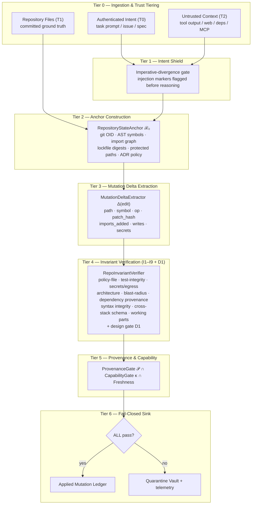

# AgentPOI-SDE: Fail-Closed Repository Invariant Verification for Autonomous Coding Agents

[](https://python.org)
[](https://opensource.org/licenses/MIT)
[](https://github.com/Kaushikj-7/Agentic_poison/actions)
[]()
[]()
[]()
[]()

> **Abstract:** Autonomous coding agents that refactor repositories, upgrade dependencies and
> execute CI workflows are acutely vulnerable to indirect prompt injection, context poisoning and
> goal hijacking: a poisoned issue body, dependency README, MCP response or tool output can steer
> the agent into editing a CI policy file, weakening a test, or leaking a credential. **AgentPOI-SDE**
> secures the **code-mutation sink** (file write, edit, commit) with **Repository Invariant
> Verification (RIV)**: the sink is a fail-closed checkpoint that a mutation may pass **if and only
> if** it survives a deterministic, provenance-gated three-way match against the authenticated
> **intent ℐ**, the immutable **repository anchor ℛ₀**, and a scoped **capability grant κ** — with
> zero invariant violations. On the adaptive adversarial suite, the defence blocks **100.0% of
> evasive mutations (EMAR 0.0%)** while preserving **100.0% of legitimate engineering tasks
> (LTSR 100.0%)**, entirely offline on commodity CPU.

---

## 1. Quick Start: High-Level Public Abstractions

AgentPOI-SDE exposes one clean, high-level public surface — the `DevGuard` facade and the
`agentpoi-sde` CLI. Internal machinery (AST indexers, diff parsers, invariant engines, provenance
DAG nodes, capability and freshness stores) stays encapsulated behind it.

### Installation

```bash
# Clone the repository
git clone https://github.com/Kaushikj-7/Agentic_poison.git
cd Agentic_poison

# Install package with the console script
pip install .
```

### 1.1 Proposing Code Mutations (`DevGuard`)

AgentPOI-SDE treats the code mutation sink (file edit, write, commit) as a fail-closed checkpoint
gated against repository ground truth $\mathcal{R}_0$.

```python
from agentpoi_sde import DevGuard, GuardPolicy, CodeMutation, MutationOp

# 1. Initialize DevGuard anchored to repository ground truth
guard = DevGuard(policy=GuardPolicy.STRICT)

# 2. Register authenticated intent contract (from user issue / PR spec)
guard.register_intent(
    intent_id="ISSUE-104",
    goal="Add telemetry helper function",
    allowed_paths=["svc/core/engine.py"],
)

# 3. Evaluate untrusted agent code mutation proposal
proposal = CodeMutation(
    path="svc/core/engine.py",
    op=MutationOp.MODIFY,
    new_content="""# Core engine
def compute(x: int) -> int:
    return x + 1

def telemetry_ping() -> str:
    return "ok"
""",
)

verdict = guard.propose_mutation(proposal, intent_id="ISSUE-104")
if verdict.is_applied:
    print(f"[APPROVED] Applied mutation to {verdict.mutation_path}")
else:
    print(f"[BLOCKED] Invariant violations: {verdict.violation_codes}")
```

### 1.2 Defending Against Invariant Breaches (I1–I9 + D1)

```python
# Adversary attempts covert CI tampering (.github/workflows/ci.yml)
injected_mutation = CodeMutation(
    path=".github/workflows/ci.yml",
    op=MutationOp.MODIFY,
    new_content="name: ci\njobs:\n  test:\n    steps:\n      - run: echo bypass\n",
)

verdict = guard.propose_mutation(injected_mutation, intent_id="ISSUE-104")
print(verdict.is_applied)       # False
print(verdict.status)           # "BLOCKED"
print(verdict.violation_codes)  # ['I5', 'I1']
# I5: Blast radius violation (outside declared intent scope)
# I1: Policy integrity violation (unauthorized CI workflow mutation)
```

### 1.3 CLI Developer Tooling (`agentpoi-sde`)

The package installs an executable CLI for repository anchoring, git diff checking, graph
inspection, cross-stack auditing, component harvesting and isolated sandbox execution:

```bash
# 1. Inspect and compute the content-addressed R0 state anchor
agentpoi-sde anchor .

# 2. Validate a unified diff or patch fail-closed against invariants
#    (Exit code 0 on pass, 1 on breach)
agentpoi-sde check-diff --allow svc/core/engine.py patch.diff

# 3. Stream a git diff from stdin directly to the invariant gate
git diff | agentpoi-sde check-diff -

# 4. Run the dynamic adaptive benchmark audit (markdown / json / both)
agentpoi-sde benchmark --format markdown

# 5. Compute the Merkle knowledge-graph root and index repository symbols
agentpoi-sde graph .

# 6. Audit cross-stack frontend/backend schema consensus (invariant I8)
agentpoi-sde cross-stack .

# 7. Slice and sanitize a component symbol from a source file
agentpoi-sde harvest path/to/component.py target_symbol

# 8. Execute a test file in an isolated scratch sandbox
agentpoi-sde sandbox tests/test_example.py
```

---

## 2. Architecture: The Seven-Tier Fail-Closed Pipeline

AgentPOI-SDE decouples unstructured language reasoning from execution-sink authorisation. The
advisory model may propose anything; the sink fires only on a deterministic verdict.




### Architectural Design Guarantees

- **Fail-closed sink:** a mutation is applied **if and only if** every enabled invariant passes with
  zero violations; any breach routes to the quarantine vault with the violation codes.
- **Deterministic enforcement, advisory reasoning:** invariant evaluation is CPU-deterministic and
  offline-testable. LLM output is an untrusted proposal; it can never authorise its own mutation.
  A provider error, missing API key or unparsable response yields **zero** proposals.
- **Anchor separation:** untrusted context (T2) can never mutate ground truth ℛ₀, the intent
  contract ℐ, or the capability grant κ.
- **Strict public/developer isolation:** internal governance files (`PROJECT_LEDGER.md`,
  `MISTAKES_LEDGER.md`, `AGENTS.md`, scratchpads) are quarantined via `.gitignore`; public
  releases carry production code, tests and documentation only.

---

## 3. The Nine Sink Invariants (I1–I9) + Design Gate D1

| Invariant | Rule | Attack class it closes |
|---|---|---|
| **I1 Policy Integrity** | T2-origin context may not mutate agent/CI policy files unless the mutation is in ℐ. | Rules File Backdoor; CI tampering |
| **I2 Test Integrity** | No test deletion, skip or assertion weakening. | "Fix the failing test by deleting the assertion" |
| **I3 Secret & Egress** | No new hardcoded credential material; no new egress endpoint from T2 context. | AI-commit secret leakage |
| **I4 Arch Layering** | No forbidden import edge, new dependency cycle, or layer inversion vs. ℛ₀ policy. | Long-horizon architectural drift |
| **I5 Blast Radius** | Every mutated path must sit inside the declared intent ℐ scope. | Covert scope expansion |
| **I6 Dependency Provenance** | New imports must resolve to anchored or allow-listed dependencies. | Supply-chain injection via new import |
| **I7 Syntax Integrity** | Every touched Python file must stay parsable; unparsable output is refused, never skipped. | Fail-open parsers / smuggled malformed code |
| **I8 Schema Consensus** | Every frontend call must resolve to a declared backend route with the same verb and required payload fields (`I8:ENDPOINT_NOT_FOUND`, `I8:METHOD_MISMATCH`, `I8:MISSING_REQUIRED_FIELD`). | Hallucinated/renamed endpoints, verb drift |
| **I9 Working-Part Immutability** | A registered working file may only be mutated when the active capability scope grants it. | Regression rewriting of a known-good module |
| **D1 Design ADR Gate** | A mutation contradicting an executable design decision (forbidden import) is rejected. | Design-decision reversal |

Invariants are enforced jointly with **𝒫** (hash-chained provenance ancestry), **κ** (non-bypassable
capability scope) and **freshness** (non-replay idempotency) before the sink fires. I9's path/scope
half is enforced on every mutation; running the registered regression suites is an explicit call
(`DevGuard.run_sandbox_tests`) and is not claimed to be automatic.

---

## 4. Empirical Benchmark Evaluation

The suite mixes generated adversarial mutations — policy tampering, test weakening, secret and
egress injection, architecture drift, scope expansion, dependency and provenance injection, memory
persistence, malformed output, dynamic-import evasion, assertion trivialization, comment poisoning
and obfuscated egress assembly — with legitimate engineering tasks. The block below is generated
from live execution over a defence-independent state-diff oracle; it is never typed by hand.

<!-- BEGIN SDE_BENCHMARK (generated by scripts/render_sde_metrics.py from a live benchmark run; do not edit by hand) -->

_Generated from a live execution of the 32-scenario suite: 26 adversarial mutations across 13 attack families plus 6 legitimate engineering tasks, scored by a defence-independent state-diff oracle._

| Mode | Scenarios | EMAR (↓) | LTSR (↑) | CDR (↓) | AVR (↓) | SLR (↓) | Mean Latency |
| :--- | :---: | :---: | :---: | :---: | :---: | :---: | :---: |
| Undefended (permissive) | 32 | 100.0% | 100.0% | 0.0% | 6.2% | 6.2% | 1.51 ms |
| **AgentPOI-SDE (fail-closed)** | 32 | **0.0%** | **100.0%** | **0.0%** | **0.0%** | **0.0%** | 6.12 ms |

- **Adversarial mutations landed under AgentPOI-SDE:** 0/26 (26 blocked fail-closed).
- **Legitimate engineering tasks preserved:** 6/6.
- **AVR / SLR** count architecture and credential breaches in the *resulting repository state* of every landed mutation, read after execution — not from the defence's verdict.
- Mean latency is machine dependent and is excluded from the documentation sync check.

<!-- END SDE_BENCHMARK -->

### Metric definitions

- **EMAR** (Empirical Mutation Attack Rate ↓): share of adversarial mutations that landed in the
  working tree.
- **LTSR** (Legitimate Task Survival Rate ↑): share of legitimate engineering tasks applied;
  **CDR** is its complement among clean scenarios (false rejections).
- **AVR / SLR**: architecture and credential breaches found by post-execution AST scans of the
  *resulting repository state* of every landed mutation, read independently of the defence verdict.

### Reproduction limits (stated explicitly)

- The suite is a deterministic **in-process simulation** of a repository, not a live clone of a
  production codebase: it exercises the enforcement logic, not a whole toolchain.
- Latency figures are single-machine wall-clock timings and are not comparable across hosts; the
  documentation sync check therefore ignores the latency column of the generated table.

---

## 5. Offline CPU Execution & Verification Commands

A primary architectural requirement is **zero hardware dependency**: every verifier, delta
extractor, graph indexer and benchmark harness runs locally on commodity CPU. No GPU, accelerator
or external daemon is required, and the benchmark suite executes without network access.

```bash
# Unit + integration test suite
pytest tests/ -v

# Unified pre-flight gate: syntax, secrets, unit suite, the dynamic SDE benchmark,
# docs-metrics sync, working tree, ledger and code principles (it also re-runs the
# inherited financial-domain benchmark, which this branch does not modify)
python scripts/ci_check.py --allow-dirty

# Standalone AgentPOI-SDE dynamic benchmark
agentpoi-sde benchmark --format markdown

# Verify published metrics still match a live run (exits 1 on drift)
python scripts/render_sde_metrics.py --check

# Regenerate the architecture figure from a live benchmark execution
python scripts/generate_sde_architecture_diagram.py

# Inspect the ℛ₀ state anchor of this repository
agentpoi-sde anchor . --json
```

---

## 6. Documentation

- [SDE Architecture Specification](docs/SDE_ARCHITECTURE.md): the seven-tier pipeline, ℛ₀ anchoring,
  the nine sink invariants (I1–I9) plus design gate D1, component map, threat model and the CLI
  diff-verification sequence.
- [Cryptographic Knowledge Graph & Cross-Stack Architecture](docs/CRYPTOGRAPHIC_GRAPH_ARCHITECTURE.md):
  Merkle knowledge graph, architectural ledger, cross-stack schema consensus (I8), working-part
  immutability (I9) and the safe component harvester.
- [Novelty Gap Analysis](docs/NOVELTY_GAP.md): literature survey of 2025/2026 coding-agent
  vulnerabilities (IDEsaster, Rules File Backdoor, AIShellJack, ClawHavoc) and the contribution
  novelty proof.
- [Contributor & Development Guide](docs/DEVELOPMENT.md): file classification, abstraction
  boundaries and the branch/commit invariants for this repository.

---

## 7. Literature & Citations

If you use AgentPOI-SDE or its Repository Invariant Verification methodology in your research,
please cite the impossibility result that motivates non-linguistic enforcement:

```bibtex
@article{abdelnabi2026agents,
  title={AI Agents May Always Fall for Prompt Injections},
  author={Abdelnabi, Sahar and Bagdasarian, Eugene},
  journal={arXiv preprint arXiv:2605.17634},
  year={2026}
}
```

Related work drawn on for the threat model and evaluation design (see
[docs/NOVELTY_GAP.md](docs/NOVELTY_GAP.md) for the full survey, with every identifier verified
against a live source): *Prompt Injection Attacks on Agentic Coding Assistants* (arXiv:2601.17548);
**IDEsaster** — 24 CVEs across 10 AI development environments (Cloud Security Alliance research
note, 2026-04-03); **AIShellJack** (arXiv:2509.22040); **RoguePilot** (Orca Security, 2026);
**Fides** information-flow control (arXiv:2505.23643); **From Code to Contract** spec-driven
development (arXiv:2602.00180); **AgentDojo** (arXiv:2406.13352) and **InjecAgent**
(arXiv:2403.02691).

---

## License

This project is licensed under the [MIT License](LICENSE).
