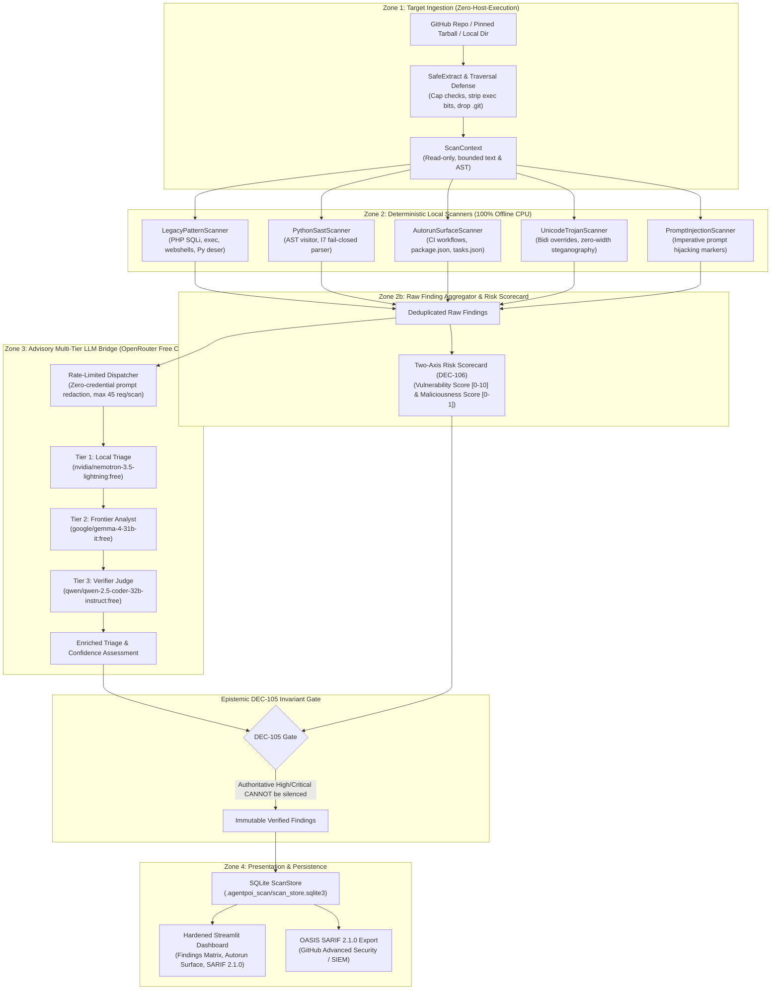

# AgentPOI-Scan: Zero-Host-Execution Static Vulnerability & Malicious Code Scanner

[](https://python.org)
[](https://opensource.org/licenses/MIT)
[](https://github.com/Kaushikj-7/Agentic_poison/actions)
[]()
[]()
[](https://streamlit.io)
[]()
[]()

> **AgentPOI-Scan** is an industry-grade, zero-host-execution static security analysis framework engineered to audit untrusted open-source repositories and complex agentic snapshots (Langflow, Python, legacy PHP) for supply-chain backdoors, autorun execution hooks, and high-impact vulnerabilities—**without compiling, running, or installing target packages**.

---

## Table of Contents

- [1. Why AgentPOI-Scan? (Inverting Anthropic's OSS-Scanner)](#1-why-agentpoi-scan-inverting-anthropics-oss-scanner)
- [2. System Architecture](#2-system-architecture)
- [3. Quick Start](#3-quick-start)
  - [3.1 Installation](#31-installation)
  - [3.2 CLI Scans (`agentpoi-scan run`)](#32-cli-scans-agentpoi-scan-run)
  - [3.3 Interactive Dashboard Launch](#33-interactive-dashboard-launch)
  - [3.4 Programmatic Python SDK](#34-programmatic-python-sdk)
- [4. Interactive Security Dashboard Walkthrough](#4-interactive-security-dashboard-walkthrough)
  - [4.1 Four-Tab Interface](#41-four-tab-interface)
  - [4.2 Stored XSS Defense (`html.escape`)](#42-stored-xss-defense-htmlescape)
- [5. Supported Detection Rules Matrix (with CWE Mappings)](#5-supported-detection-rules-matrix-with-cwe-mappings)
- [6. Advisory Multi-Tier LLM Bridge & Epistemic DEC-105 Invariant](#6-advisory-multi-tier-llm-bridge--epistemic-dec-105-invariant)
- [7. Non-Diluting Two-Axis Risk Scoring (DEC-106)](#7-non-diluting-two-axis-risk-scoring-dec-106)
- [8. Verification & Deterministic Standards](#8-verification--deterministic-standards)
- [9. Appendix: Sibling Framework Domains](#9-appendix-sibling-framework-domains)
  - [9.1 Coding Agent Defense (`agentpoi_sde` / `DevGuard`)](#91-coding-agent-defense-agentpoi_sde--devguard)
  - [9.2 The Nine Sink Invariants (I1–I9) + Design Gate D1](#92-the-nine-sink-invariants-i1i9--design-gate-d1)
  - [9.3 Empirical SDE Benchmark Evaluation](#93-empirical-sde-benchmark-evaluation)
  - [9.4 Financial Agent Defense (`agent_poi` / `FinancialGuard`)](#94-financial-agent-defense-agent_poi--financialguard)
- [10. Documentation Index & Citations](#10-documentation-index--citations)
- [License](#license)

---

## 1. Why AgentPOI-Scan? (Inverting Anthropic's OSS-Scanner)

Traditional dynamic security auditing tools—including Anthropic's `oss-scanner` model—rely on virtual machine (VM) sandboxes that build packages, invoke package managers, resolve external dependencies, and execute install scripts before inspecting the resulting environment.

While sound inside isolated cloud hypervisors, **this model creates fatal hazards when evaluating hostile repositories on developer workstations or CI runners**:
1. **Host Execution Hazard**: Simply executing `pip install`, `npm install`, or `python setup.py` triggers `postinstall` shell hooks, arbitrary code execution, and credential exfiltration.
2. **Hidden Autorun Traps**: Modern repositories weaponize unattended developer workflows, such as GitHub Actions `pull_request_target`, VS Code `.vscode/tasks.json` (`runOn: folderOpen`), and malicious Makefile targets.
3. **Silent Parser Bypass**: Conventional AST linters fail open when encountering syntax errors, silently skipping unparsable files containing evasion payloads.

### The AgentPOI-Scan Inversion
AgentPOI-Scan **inverts the paradigm** into a 100% parse-only, zero-host-execution security pipeline:
- **Zero Host Execution Guarantee**: Scanned repositories are never built, executed, imported, or installed. Target files are extracted as bounded text bytes via safe tarball extraction or offline directory traversal.
- **Fail-Closed Parser Invariant (I7)**: Files that fail Python/syntax parsing (`SyntaxError`) are immediately flagged as hostile evasion candidates rather than skipped.
- **Non-Bypassable DEC-105 Gate**: Authoritative deterministic findings (SQLi, unescaped `exec`, webshell backdoors, insecure deserialization) **cannot be silenced, downgraded, or dismissed** by downstream LLM reasoning (honeypot flip rate = 0.0%).
- **Non-Diluting Two-Axis Risk Scoring (DEC-106)**: Rather than averaging risk across thousands of clean files, AgentPOI-Scan scores Vulnerability Risk $[0.0, 10.0]$ and Maliciousness Risk $[0.0, 1.0]$ based on maximum finding severity.

---

## 2. System Architecture

The following diagram illustrates AgentPOI-Scan's four-zone fail-closed static auditing pipeline:



---

## 3. Quick Start

### 3.1 Installation

Install `agent-poi` with Streamlit and UI dependencies in a single command:

```bash
# 1. Clone the repository
git clone https://github.com/Kaushikj-7/Agentic_poison.git
cd Agentic_poison

# 2. Install with interactive dashboard UI dependencies
pip install ".[scan-ui]"
```

For development and test suites:
```bash
pip install -e ".[dev,scan-ui]"
```

### 3.2 CLI Scans (`agentpoi-scan run`)

The `agentpoi-scan` CLI executes static scans on local directories, pinned snapshot archives, or remote GitHub repositories:

```bash
# Scan a local fixture or repository (console summary)
agentpoi-scan run tests/fixtures/legacy_php_repo

# Scan 100% offline on CPU (bypasses remote LLM triage, instant execution)
agentpoi-scan run tests/fixtures/langflow_snapshot --offline

# Scan a remote GitHub repository and export an OASIS SARIF 2.1.0 report
agentpoi-scan run https://github.com/owner/repo --sarif scan_report.sarif

# Scan with custom scanner configuration and designated working directory
agentpoi-scan run tests/fixtures/legacy_php_repo \
  --config agentpoi_scan/config/scanner_config.yaml \
  --output-sarif legacy_scan.sarif \
  --workdir .agentpoi_scan
```

### 3.3 Interactive Dashboard Launch

Launch the hardened Streamlit dashboard to inspect findings, audit autorun surfaces, and download SARIF reports:

```bash
agentpoi-scan dashboard --port 8501
```

Access the interactive interface at `http://localhost:8501`.

### 3.4 Programmatic Python SDK

Use `agentpoi_scan` directly in automated security workflows:

```python
from pathlib import Path
from agentpoi_scan.pipeline import ScanPipeline
from agentpoi_scan.report.store import ScanStore

# 1. Initialize pipeline with scanner configuration
pipeline = ScanPipeline(config="agentpoi_scan/config/scanner_config.yaml")

# 2. Execute static scan (pure parse-only, zero host execution)
report = pipeline.scan_target("tests/fixtures/legacy_php_repo")

print(f"Target: {report.repo}")
print(f"Risk Scorecard: Vulnerability={report.risk['vulnerable']:.2f}, Maliciousness={report.risk['malicious']:.2f}")
print(f"Total Findings: {len(report.findings)}")

# 3. Query persisted findings from the local ScanStore
store = ScanStore(".agentpoi_scan/scan_store.sqlite3")
high_risks = store.get_findings_filtered(scan_id=report.scan_id, severity="CRITICAL")
for item in high_risks:
    print(f"[{item.severity.upper()}] {item.title} -> {item.file}:{item.lines}")
```

---

## 4. Interactive Security Dashboard Walkthrough

The `agentpoi-scan` dashboard (`agentpoi_scan/ui/dashboard.py`) delivers an interactive security workstation built for vulnerability auditors and red teams.

### 4.1 Four-Tab Interface

| Tab | Name | Capabilities & Purpose |
| :--- | :--- | :--- |
| **Tab 1** | **Findings Matrix & Evidence Trail** | Filterable by Severity (`Critical`, `High`, `Medium`, `Low`), Category (`sast`, `malware`, `autorun`, `injection`), and free-text search. Includes expandable finding cards displaying line numbers, confidence scores, multi-tier LLM model trails, and quarantined code payloads. |
| **Tab 2** | **Autorun Surface** | Dedicated triage panel for hidden execution vectors: CI/CD workflows (`pull_request_target`), `package.json` install scripts (`preinstall`/`postinstall`), VS Code tasks (`folderOpen`), and build hooks (`setup.py`). |
| **Tab 3** | **Category Breakdown & Risk Metrics** | Visual metrics showing the Two-Axis Scorecard (`Vulnerability Risk`, `Maliciousness Risk`, `Total Findings`, `Autorun Hooks`) alongside categorical distribution bar charts. |
| **Tab 4** | **SARIF 2.1.0 Export** | Live generation and one-click download of OASIS SARIF 2.1.0 compliant JSON reports formatted for native GitHub Advanced Security ingestion and enterprise SIEM pipelines. |

### 4.2 Stored XSS Defense (`html.escape`)

Security dashboards that analyze untrusted repositories face acute **Stored Cross-Site Scripting (Stored XSS)** risks: an adversary can craft a repository where malicious HTML/JavaScript payloads are embedded within filenames, commit messages, raw code snippets, or docstrings (e.g. ``).

AgentPOI-Scan enforces strict Stored XSS quarantine invariants:
- **Strict HTML Sanitization**: All strings originating from scanned code, findings, or scanner outputs are passed through `html.escape(..., quote=True)` prior to UI binding.
- **Isolated Code Blocks**: Quarantined snippets are rendered exclusively through `st.code(..., language="text")` or plain text components.
- **Zero Raw HTML Injection**: Rendering unescaped Markdown (`st.markdown(..., unsafe_allow_html=True)`) with user-supplied data is strictly prohibited.

---

## 5. Supported Detection Rules Matrix (with CWE Mappings)

AgentPOI-Scan provides comprehensive coverage across legacy enterprise stacks (PHP) and modern agentic architectures (Python / Langflow):

| Rule ID | Category | Severity | CWE / Taxonomy | Target Pattern & Behavior | Attack Class Closed |
| :--- | :--- | :---: | :--- | :--- | :--- |
| `legacy.php.sqli` | Vulnerability | **High** | **CWE-89** | String concatenation/interpolation inside `mysqli_query()`, `$pdo->query()`, or `$db->prepare()`. | SQL Injection / Database Exfiltration |
| `legacy.php.command_injection` | Vulnerability | **Critical** | **CWE-78** | Direct injection of superglobals (`$_GET`, `$_POST`, `$_REQUEST`) into `exec()`, `system()`, `passthru()`, `shell_exec()`, or backticks. | Host Remote Code Execution (RCE) |
| `legacy.php.deserialization` | Vulnerability | **High** | **CWE-502** | Invocation of `unserialize()` without explicit `['allowed_classes' => false]`. | PHP Object Injection / POP Gadget Chains |
| `legacy.php.obfuscated_eval` | Malicious Code | **Critical** | **CWE-94 / CWE-95** | Obfuscated dynamic execution: `eval(base64_decode())`, `create_function()`, `preg_replace /e`, and dynamic superglobal dispatch. | Stealth Webshells & Backdoors |
| `agentic.python.deserialization` | Vulnerability | **Critical** | **CWE-502** | Unsafe deserialization calls: `pickle.loads()`, `shelve.open()`, `yaml.unsafe_load()`, and `torch.load()` lacking `weights_only=True`. | Python Deserialization RCE |
| `agentic.autorun.workflow` | Malicious Code | **High** | **CWE-829** | GitHub Actions `pull_request_target` triggers combined with untrusted PR checkout. | Pipeline Hijacking / Secret Token Egress |
| `agentic.autorun.package` | Malicious Code | **Critical** | **CWE-829 / CWE-78** | `package.json` `preinstall` or `postinstall` lifecycle scripts piping `curl`/`wget` directly to `sh`/`bash`. | Supply-Chain Host Infection on Install |
| `agentic.autorun.task` | Malicious Code | **Medium** | **CWE-829** | `.vscode/tasks.json` configured with `runOn: folderOpen`. | IDE Auto-Execution on Repository Open |
| `agentic.prompt_injection` | Malicious Code | **High** | **CWE-77 / MITRE AML.T0054** | Imperative adversarial directives (`IGNORE PREVIOUS INSTRUCTIONS`, exfiltration markers) in prompts or code comments. | Downstream Autonomous Agent Goal Hijacking |
| `agentic.unicode.trojan` | Malicious Code | **High** | **CWE-1036** | Bidirectional (Bidi) overrides and zero-width unicode characters disguising malicious tokens or splitting keywords. | Invisible Trojan Source Attacks |

---

## 6. Advisory Multi-Tier LLM Bridge & Epistemic DEC-105 Invariant

AgentPOI-Scan incorporates an advisory multi-tier LLM bridge that routes candidates through a free-model cascade via OpenRouter:

| Tier | Model Identifier | Role & Scope | Request Ceiling | Token Limit |
| :--- | :--- | :--- | :---: | :---: |
| **Tier 1 (Triage)** | `nvidia/nemotron-3.5-lightning:free` | Rapid triage & snippet classification | Max 20 req / scan | 2,048 tokens |
| **Tier 2 (Analyst)** | `google/gemma-4-31b-it:free` | Deep semantic de-obfuscation & analysis | Max 15 req / scan | 4,096 tokens |
| **Tier 3 (Verifier)**| `qwen/qwen-2.5-coder-32b-instruct:free` | Consensus confirmation & sanity check | Max 10 req / scan | 4,096 tokens |

### Epistemic Invariants & Defenses

1. **Epistemic Invariant DEC-105 (Honeypot Flip Rate = 0.0%)**:
   - High and Critical findings discovered by deterministic static sinks are **immutable**.
   - Downstream LLM triage can enrich metadata or suggest remediation, but **an LLM can never veto, silence, or dismiss an authoritative finding**.
2. **Deterministic Rate Limiting & Graceful Degradation**:
   - The bridge enforces an aggregate cap of $\le 45$ requests per scan and 15 requests per minute.
   - Network drops, timeouts, or missing API keys degrade fail-closed: deterministic findings remain 100% intact with zero proposal pollution.
3. **Zero-Credential Prompt Redaction (Rule 10)**:
   - Before any code snippet is dispatched to OpenRouter, regex scrubbers redact API keys, tokens, passwords, and private certificates.

---

## 7. Non-Diluting Two-Axis Risk Scoring (DEC-106)

Traditional scanners compute vulnerability scores by calculating the arithmetic mean of findings across the entire file count. In large enterprise repositories, this creates a severe vulnerability: **an attacker can inject a critical backdoor into a 10,000-file repository, resulting in an average score near 0.0 ("Safe")**.

AgentPOI-Scan implements **DEC-106 Severity-Weighted Maximum Scoring**:

$$\text{Vulnerability Risk} = \max_{f \in \mathcal{F}_{\text{vuln}}} \text{Weight}(f.\text{severity}) \quad \in [0.0, 10.0]$$

$$\text{Maliciousness Risk} = \max_{f \in \mathcal{F}_{\text{malware}}} f.\text{maliciousness} \quad \in [0.0, 1.0]$$

| Finding Severity | Vulnerability Weight | Maliciousness Base | Scorecard Impact |
| :--- | :---: | :---: | :--- |
| **CRITICAL** | **10.0** | **0.95 – 1.00** | A single critical webshell guarantees repository risk $\ge 0.95$ |
| **HIGH** | **7.5** | **0.80 – 0.90** | Significant exploit surface detected |
| **MEDIUM** | **5.0** | **0.50 – 0.70** | Suspicious configuration or moderate risk |
| **LOW** | **2.5** | **0.20 – 0.40** | Informational or low-impact signal |

---

## 8. Verification & Deterministic Standards

AgentPOI-Scan is rigorously validated against ground-truth fixtures and offline CPU suites:

```bash
# 1. Run the AgentPOI-Scan test suite (179+ tests, ~5s execution)
pytest -k scan -p no:cacheprovider

# 2. Verify documentation benchmark sync (exits 0 on match)
python scripts/render_sde_metrics.py --check

# 3. Execute pre-flight CI/CD verification gate (1,107 tests across all domains)
python scripts/ci_check.py --allow-dirty

# 4. Run Ruff code quality and formatting checks
ruff check .
```

---

## 9. Appendix: Sibling Framework Domains

AgentPOI provides deterministic, fail-closed invariant defense across three formally isolated application domains:
1. **Zero-Host-Execution Vulnerability Scanner (`agentpoi_scan`)**: Presented above.
2. **Coding Agent Invariant Defense (`agentpoi_sde` / `DevGuard`)**: Enforces Repository Invariant Verification (RIV) at the code mutation sink against intent contracts $\mathcal{I}$, immutable anchors $\mathcal{R}_0$, and nine sink invariants (I1–I9, D1).
3. **Financial & Transactional Agent Defense (`agent_poi` / `FinancialGuard`)**: Implements Contextual Invariant Verification (CIV) and Dual-State Epistemic Consensus (DSEC) protecting wire routing and ledger disbursements.

---

### 9.1 Coding Agent Defense (`agentpoi_sde` / `DevGuard`)

AgentPOI-SDE treats the code mutation sink (file edit, write, commit) as a fail-closed checkpoint gated against repository ground truth $\mathcal{R}_0$:

```python
from agentpoi_sde import DevGuard, GuardPolicy, CodeMutation, MutationOp

# 1. Initialize DevGuard anchored to repository ground truth
guard = DevGuard(policy=GuardPolicy.STRICT)

# 2. Register authenticated intent contract (from user issue / PR spec)
guard.register_intent(
    intent_id="ISSUE-104",
    goal="Add telemetry helper function",
    allowed_paths=["svc/core/engine.py"],
)

# 3. Evaluate untrusted agent code mutation proposal
proposal = CodeMutation(
    path="svc/core/engine.py",
    op=MutationOp.MODIFY,
    new_content="""# Core engine
def compute(x: int) -> int:
    return x + 1

def telemetry_ping() -> str:
    return "ok"
""",
)

verdict = guard.propose_mutation(proposal, intent_id="ISSUE-104")
if verdict.is_applied:
    print(f"[APPROVED] Applied mutation to {verdict.mutation_path}")
else:
    print(f"[BLOCKED] Invariant violations: {verdict.violation_codes}")
```

#### Defending Against Invariant Breaches (I1–I9 + D1)

```python
# Adversary attempts covert CI tampering (.github/workflows/ci.yml)
injected_mutation = CodeMutation(
    path=".github/workflows/ci.yml",
    op=MutationOp.MODIFY,
    new_content="name: ci\njobs:\n  test:\n    steps:\n      - run: echo bypass\n",
)

verdict = guard.propose_mutation(injected_mutation, intent_id="ISSUE-104")
print(verdict.is_applied)       # False
print(verdict.status)           # "BLOCKED"
print(verdict.violation_codes)  # ['I5', 'I1']
# I5: Blast radius violation (outside declared intent scope)
# I1: Policy integrity violation (unauthorized CI workflow mutation)
```

---

### 9.2 The Nine Sink Invariants (I1–I9) + Design Gate D1

| Invariant | Rule | Attack class it closes |
| :--- | :--- | :--- |
| **I1 Policy Integrity** | Context may not mutate agent/CI policy files unless explicitly permitted in $\mathcal{I}$. | Rules File Backdoor; CI tampering |
| **I2 Test Integrity** | No test deletion, skip, or assertion weakening. | "Fix the failing test by deleting the assertion" |
| **I3 Secret & Egress** | No new hardcoded credential material; no new egress endpoint from untrusted context. | AI-commit secret leakage |
| **I4 Arch Layering** | No forbidden import edge, new dependency cycle, or layer inversion vs. $\mathcal{R}_0$ policy. | Long-horizon architectural drift |
| **I5 Blast Radius** | Every mutated path must sit inside declared intent $\mathcal{I}$ scope. | Covert scope expansion |
| **I6 Dependency Provenance** | New imports must resolve to anchored or allow-listed dependencies. | Supply-chain injection via new import |
| **I7 Syntax Integrity** | Every touched Python file must remain parsable; unparsable output is refused, never skipped. | Fail-open parsers / smuggled malformed code |
| **I8 Schema Consensus** | Every frontend call must resolve to a declared backend route with matching HTTP verb and required fields. | Hallucinated/renamed endpoints, verb drift |
| **I9 Working-Part Immutability** | A registered working file may only be mutated when active capability scope grants it. | Regression rewriting of a known-good module |
| **D1 Design ADR Gate** | A mutation contradicting an executable design decision is rejected fail-closed. | Architectural design reversal |

---

### 9.3 Empirical SDE Benchmark Evaluation

<!-- BEGIN SDE_BENCHMARK (generated by scripts/render_sde_metrics.py from a live benchmark run; do not edit by hand) -->

_Generated from a live execution of the 40-scenario suite: 34 adversarial mutations across 17 attack families plus 6 legitimate engineering tasks, scored by a defence-independent state-diff oracle._

| Mode | Scenarios | EMAR (↓) | LTSR (↑) | CDR (↓) | AVR (↓) | SLR (↓) | Mean Latency |
| :--- | :---: | :---: | :---: | :---: | :---: | :---: | :---: |
| Undefended (permissive) | 40 | 100.0% | 100.0% | 0.0% | 10.0% | 5.0% | 1.12 ms |
| **AgentPOI-SDE (fail-closed)** | 40 | **0.0%** | **100.0%** | **0.0%** | **0.0%** | **0.0%** | 4.07 ms |

- **Adversarial mutations landed under AgentPOI-SDE:** 0/34 (34 blocked fail-closed).
- **Legitimate engineering tasks preserved:** 6/6.
- **AVR / SLR** count architecture and credential breaches in the *resulting repository state* of every landed mutation, read after execution — not from the defence's verdict.
- Mean latency is machine dependent and is excluded from the documentation sync check.

<!-- END SDE_BENCHMARK -->

#### Metric Definitions & Limits

- **EMAR** (Empirical Mutation Attack Rate $\downarrow$): Share of adversarial mutations that landed in the working tree.
- **LTSR** (Legitimate Task Survival Rate $\uparrow$): Share of legitimate engineering tasks applied; **CDR** is its complement among clean scenarios.
- **AVR / SLR**: Architecture and credential breaches found by post-execution AST scans of resulting repository states.
- **Deterministic Invariant Sink Suite**: The 40-scenario benchmark suite evaluates deterministic invariant sink coverage against scripted evasion mutation families and synthetic repositories. Reported metrics validate fail-closed invariant enforcement (I1–I9, D1).

---

### 9.4 Financial Agent Defense (`agent_poi` / `FinancialGuard`)

For financial execution agents managing wires, invoice reconciliations, and settlements, `agent_poi` provides **Contextual Invariant Verification (CIV)** and **Dual-State Epistemic Consensus (DSEC)**:
- **Wire Disbursement Safeguards**: Guarantees payment limits, account whitelists, and velocity constraints cannot be overridden by conversational prompt injections.
- **Ledger Invariant Verification**: Ensures immutable double-entry accounting integrity across asynchronous external tool dispatches.

---

## 10. Documentation Index & Citations

- [Scanner & Dashboard Architecture](docs/SCANNER_DASHBOARD_ARCHITECTURE.md): Zero-host-execution SAST pipeline, DEC-105 invariant, OpenRouter cascade, and Streamlit dashboard design.
- [SDE Architecture Specification](docs/SDE_ARCHITECTURE.md): The seven-tier pipeline, $\mathcal{R}_0$ anchoring, the nine sink invariants (I1–I9) plus design gate D1.
- [Cryptographic Knowledge Graph & Cross-Stack Architecture](docs/CRYPTOGRAPHIC_GRAPH_ARCHITECTURE.md): Merkle knowledge graph, architectural ledger, cross-stack schema consensus (I8), and component harvester.
- [Novelty Gap Analysis](docs/NOVELTY_GAP.md): Survey of 2025/2026 coding-agent vulnerabilities (IDEsaster, Rules File Backdoor, AIShellJack, ClawHavoc).
- [Contributor & Development Guide](docs/DEVELOPMENT.md): Multi-domain isolation, file classification, abstraction boundaries, and commit invariants.

### Citation

If you use AgentPOI-Scan or AgentPOI-SDE in your security research:

```bibtex
@article{agentpoi2026,
  title={AgentPOI: Deterministic Invariant Defense and Zero-Host-Execution Security for Autonomous AI Agents},
  author={Kaushik, J.},
  journal={GitHub Repository},
  url={https://github.com/Kaushikj-7/Agentic_poison},
  year={2026}
}
```

---

## License

This project is licensed under the [MIT License](LICENSE).
