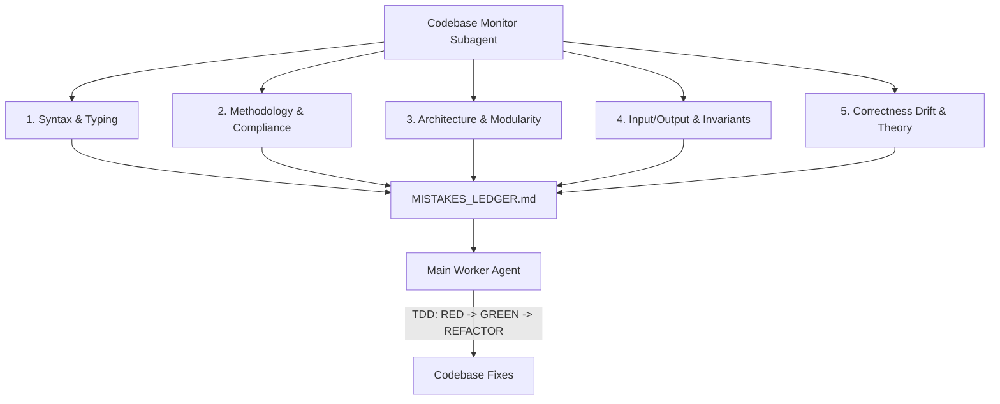

# Autonomous Codebase Monitor & Mistake Ledger Protocol

## Overview

The `agent_poi` repository enforces a strict **Worker-Monitor Separation of Concerns**:
- **Main Agent (Worker)**: Responsible for code implementation, refactoring, test-driven development (TDD), and executing fixes.
- **`codebase_monitor` Subagent (Supervisory Auditor)**: Strictly read-only (`enable_write_tools=False`). It continuously inspects the codebase, discovers bugs, detects epistemic invariant violations, compiles a structured **Mistake Ledger**, and reports actionable findings to the main worker agent. The monitor agent makes zero modifications to the codebase.

---

## 5 Monitored Audit Dimensions

### 1. [SYNTAX]
- AST syntax validation, valid module imports, symbol resolution.
- Static typing accuracy (avoiding built-in function names like `any` in place of `typing.Any`).
- Variable scoping, uninitialized identifiers, and unhandled exceptions.

### 2. [METHODOLOGY]
- Adherence to `everything-claude-code` and `AGENTS.md`.
- Test-Driven Development (TDD) coverage ($\ge 80\%$).
- Single-Domain Financial Constraint (wire disbursements, invoice verification, escrow settlement, ledger reconciliation).
- Single source of truth across configuration (`config.yaml`) and runtime parameters.

### 3. [ARCHITECTURE]
- **Many Small Files Principle**: Target 200–400 lines typical, max 800 lines per file.
- **Function Granularity**: Functions $\le 50$ lines, control flow nesting $\le 4$ levels.
- High cohesion, loose coupling, avoidance of God objects, clear modular boundaries (`core`, `memory`, `financial`, `evaluation`, `ui`).

### 4. [INPUT_OUTPUT]
- Input sanitization (preventing amount truncation, boundary checks on disbursements $0 < a < \infty$).
- Epistemic Invariant Verification against Immutable State Anchor $\mathcal{S}_0$.
- Zero hardcoded credentials, tokens, or plaintext secrets.
- Sink Authorization: Mandatory cryptographic ancestry validation (`AuthGraphDAG` and `TaskShieldGate`) on all high-risk execution sinks (`process_disbursement`).

### 5. [CORRECTNESS_DRIFT]
- Mathematical and theoretical fidelity to CTP exponential decay and geometric taint propagation.
- Unbiased and genuine evaluation standards (no synthetic mock illusions or hardcoded passes).
- Preservation of benchmark metrics (`ASR-Exec`, `LDSR`, `CDR`).

---

## Communication & Remediation Lifecycle

1. **Invoke Auditor**: The main worker agent triggers `codebase_monitor` via `invoke_subagent`.
2. **Diagnostic Scan**: `codebase_monitor` scans the AST, files, tests, and configuration without touching code.
3. **Report & Mistake Ledger**: The monitor generates the Mistake Ledger and sends it back to the main agent.
4. **Worker Ledger Update**: The main worker agent records the findings in [`MISTAKES_LEDGER.md`](file:///E:/agent_poi/MISTAKES_LEDGER.md).
5. **Worker TDD Remediation**: Following `/plan` confirmation, the main worker agent writes failing tests (RED), applies the fixes (GREEN), refactors (REFACTOR), and re-verifies.
