# Agentic OSS Vulnerability Scanner — Architecture Plan

**Status:** PLAN ONLY — nothing implemented, no code touched (per `/plan` methodology).
**Branch:** `codebleak`. Working name of the new package: `agentpoi_scan/` (third package, sibling of `agent_poi/` and `agentpoi_sde/`).

---

## 0. Requirements

| # | Requirement |
|---|---|
| R1 | Scan arbitrary GitHub open-source repositories for **vulnerabilities** (accidental bugs) and **malicious code** (intentional harm). |
| R2 | **Zero execution** of scanned content, enforced by construction — the repo is attacker-controlled and must not be able to affect the host at all. |
| R3 | Report findings through a **dashboard** showing exactly *where* code might be vulnerable or malicious, with full evidence, without "running" anything. |
| R4 | **Agentic** analysis with tiered models: cheap local/non-frontier triage + frontier deep analysis + an independent verifier. |
| R5 | Built on the **anthropics/oss-scanner** service model, reusing `agentpoi_sde` / `agent_poi` modules where they map. |
| R6 | Every swappable piece behind a Protocol + one YAML config; many small files (200–400 lines, per `AGENTS.md` §1). |

---

## 1. What `anthropics/oss-scanner` actually is — and what we take from it

The repo is **not a scanner library**. Its README confirms the scanning machinery (the agent and VM pipeline) runs on Anthropic's side; the repo ships only the **enrollment surface** and validator tooling. We adopt its conventions, not its internals.

| OSS Scanner artifact | What it is | Our verdict |
|---|---|---|
| `projects/<name>/project.yaml` | Enrollment record: `repo`, `primary_contact`, `auto_ccs`, `disabled`, output channels | **Adopt.** Our `scan_registry/<name>/project.yaml` (same keys, minus email/PGP) declares scan targets. Validates like `tools/validate.py` does. |
| `Dockerfile` (per project) | Build spec: install deps, build project | **Rejected for static scans.** Building executes install scripts and build code directly against R2. Kept only for a future **opt-in `verified_build` mode** in a separate zone (see §2.3). |
| `tools/check [--qemu]`, `tools/validate.py` | Local dry-run of the scanner's build+audit loop; enrollment validation | **Adopt the pattern**, statically: `tools/validate_registry.py` validates target records and snapshot fetch; no build shell. |
| `threat_model.md` (optional) | Per-project threat policy read by the agent | **Adopt.** Feeds the LLM per-repo severity and scope guidance. |
| "Build in isolated VM → move VM to no-Internet zone → scan" | Their audit discipline | **Adapt** to static: snapshot extraction → parse-only scan zone with no network. The *agent* zone has LLM egress but sees only redacted snippets. |
| Claude Code installed in the image | Their frontier agent | **Adopt the pattern** for the deep-analyst phase only (§6); wrapped, schema-constrained, read-only. |
| Findings emailed with reproducer + proposed patch | Delivery format | **Adapt:** dashboard + SARIF/CSV export replace email as primary; email/webhook adapters behind the Report protocol. |

**Hard rule carried over from them, deliberately inverted:** they build-then-scan; we **scan, never build**. Anything that runs installers, tests, builds, or Let's-encrypt-style verification (`TruffleHog --no-verification` for the same reason) is disallowed in the default pipeline.

---

## 2. The no-execution invariant (enforced by construction)

### 2.1 Zone 1 — Fetch
- Download a **tarball for one pinned commit SHA** via the GitHub API. Never `git clone` a full checkout with `.git/` present (`delta/diff_parser.py`, which shells out to `git`, is never pointed at untrusted checkouts for this reason).
- Extract with Python `tarfile` using `filter="data"`; hard caps on **file count, total size, and path depth**; strip symlinks, hardlinks, exec bits, device nodes; explicitly drop `.git/`, `.gitmodules` LFS pointers resolved.
- Output: an immutable `snapshot/` directory plus a `manifest.json` (path → size, sha256, language estimate).

### 2.2 Zone 2 — Static scan (no network)
- Every scanner runs as a **parse-only process in a throwaway container**: `--network none`, `--read-only` rootfs, `--cap-drop ALL`, `--security-opt no-new-privileges`, non-root, CPU/mem/time limits, snapshot mounted `:ro,noexec`.
- **Never** run package managers, test suites, builds, or build-mode CodeQL. Parse lockfiles instead; CodeQL only in `build-mode none`, if used at all.
- Binaries and blobs are **flagged, never opened**: YARA/capa/magic-byte + entropy checks only.

### 2.3 Zone 3 — Agent/LLM (egress = LLM API only)
- Models see **only snippets served from Zone 2** (redacted, size-capped, wrapped in randomized untrusted-data delimiters). Models never touch the filesystem, shell, or network beyond the model API.
- `local_only` mode: swap frontier providers for local inference and set egress to none.

### 2.4 Explicitly forbidden on untrusted data (permanent)
- `agentpoi-sde sandbox`, `DevGuard.run_sandbox_tests`, `agentpoi_sde.sandbox.isolated_sandbox.*` — it `subprocess.run`s generated tests; its "network isolation" is an in-process socket monkeypatch, bypassable via `os.system`/`ctypes`.
- `verified_build` mode, if ever built: separate zone, separate machine, separate credentials, default OFF, never mixed with static results.

### 2.5 Host-weakness acknowledgment
On Windows hosts without Docker/WSL2, Zone 2 degrades to in-process, parse-only Python tools (equivalent containment: weaker). The dashboard must display the per-scan **isolation level** (`container | in-process`) so weak containment is never confused with strong.

---

## 3. Four-zone data flow

```mermaid
flowchart LR
    subgraph Z1["Zone 1 · Fetch (network)"]
        F["fetch/snapshot_client.py\ntarball @ pinned SHA"] --> X["fetch/safe_extract.py\ntarfile filter='data' + caps"] --> S["snapshot/ + manifest.json"]
    end
    subgraph Z2["Zone 2 · Static scan (no network)"]
        S --> SC["Scanner adapters in containers\nsemgrep · gitleaks · OSV · Syft · YARA\nzizmor · checkov · slicer_security"]
        SC --> N["scan/normalize_sarif.py\ndedupe + Finding model"]
    end
    subgraph Z3["Zone 3 · Agents (LLM egress only)"]
        N --> T["Triage (local tier)"]
        T --> R{"Router\n(config policy)"}
        R -->|escalate| A["Deep analyst (frontier)\nread-only tools"]
        R --> A["Verifier (2nd family)\ntries to refute"]
        A --> V["Persist"]
        V --> P
    end
    subgraph Z4["Zone 4 · Dashboard"]
        P["report/store.py\nPostgres + SARIF"] --> D["FastAPI + Streamlit"]
    end
```



---

## 4. Package layout & swappable interfaces

New third package (per AGENTS.md strict domain isolation; `AGENTS.md` §2 gains a third domain when built):

```
agentpoi_scan/
  fetch/
    snapshot_client.py      # GitHub API tarball fetch, SHA pinning
    safe_extract.py         # tarfile filter="data", caps, symlink stripping
    registry.py             # loads scan_registry/<name>/project.yaml (OSS-Scanner format)
  scan/
    base.py                 # class Scanner(Protocol): name; run(snapshot: Path) -> list[Finding]
    parse_metadata.py       # lockfiles, SBOM (Syff), language & autorun-surface discovery
    adapters/
      semgrep_adapter.py    # pinned local rules, --metrics=off
      secrets_adapter.py    # gitleaks / trufflehog --no-verification
      osv_adapter.py        # OSV-Scanner/+offline DB, MAL- advisory match
      yara_adapter.py       # custom rules + ClamAV signatures
      ci_iac_adapter.py     # zizmor, actionlint, checkov, hadolint, shellcheck
      python_sast_adapter.py# wraps agentpoi_sde.harvester.slicer_security (parse-only)
      unicode_trojan_adapter.py  # bidi/homoglyph/zero-width Trojan Source
      autorun_surface_adapter.py # setup.py', pre/post-install, tasks.json folderOpen,
                                 # devcontainers, husky/pre-commit, Makefile curl|sh,
                                 # pull_request_target workflows
    normalize_sarif.py      # scanner-output → canonical Finding
  findings/
    model.py                # Finding (see §5)
    risk_score.py           # per-repo risk = weighted MAX (not mean), two axes
  agents/
    orchestrator.py         # LangGraph state machine (profile→scan→triage→route→analyze→verify→persist)
    triage.py               # local-tier verdict {verdict, confidence, reason, escalate}
    analyst.py              # frontier cross-file taint / exploitability / intent
    verifier.py             # second model family, refute-only
    router.py               # escalation policy from config
    context_server.py       # redaction + snippet serving + delimiting (quarantined-reader)
  llm/
    provider.py             # ModelProvider.complete(prompt, schema, tier) -> dict
                            # wraps agent/llm_provider.py routing hub; strips CodeMutation coupling
    schemas.py              # pydantic response schemas per agent
  report/
    store.py                # findings persistence (queryable)
    sarif.py                # SARIF 2.1 + CSV export
  ui/
    scan_tab.py             # Streamlit "Repo Scan" tab (adapt ui/app.py)
  config/
    scanner_config.yaml     # the ONE config file (§7)
  tools/
    validate_registry.py    # OSS-Scanner-style target validation
    eval_corpus.py          # loads the test corpus + honeypots (§9)
```

**Interface guarantees:** adding a scanner = one adapter file; swapping a model = one YAML line; changing escalation = one YAML stanza. No core edits.

---

## 5. Finding model & scoring

```jsonc
// every finding, scanner- or LLM-sourced
{
  "fingerprint": "sha256(rule_id + file + line range normalization)",
  "commit_sha": "pinned SHA",
  "file": "path/in/snapshot", "lines": [12, 40],
  "source": "scanner | llm_triage | llm_analyst | llm_verifier",
  "category": "sast | secrets | deps | malware | ci_iac | injection | autorun | unicode_trojan | binary",
  "severity": "critical | high | medium | low",
  "confidence": 0.0-1.0,
  "maliciousness": 0.0-1.0,        // intentional-harm axis
  "vulnerability": 0.0-1.0,        // accidental-bug axis
  "evidence": [ { "kind": "scanner_output | model_reasoning | verifier_verdict | call_graph", "text": "..." } ],
  "model_trail": [ "triage:qwen2.5-coder:14b", "analyst:claude-sonnet-5-5", "verifier:llama3-70b" ],
  "status": "open | confirmed | refuted | escalated | human_review"
}
```

**Repo risk score = weighted max, not average**, so one backdoor isn't diluted by 500 clean files. Two separate axes are surfaced (`vulnerable` and `malicious`) and the dashboard shows both. Authoritative-deterministic `high`/`critical` scanner findings **cannot** be silenced by models — only annotated, or refuted jointly by verifier + explicit human flag.

---

## 6. Tiered agent design (Zone 3, LangGraph)

| Agent | Model tier | Input | Tool access | Output (schema-validated JSON) |
|---|---|---|---|---|
| **Triage** | Local/non-frontier (Ollama, e.g. Qwen-coder-class, or DeepSeek via routing hub) | 1 finding + ~30 context lines | none | `{verdict, confidence, reason, escalate}` |
| **Deep analyst** | Frontier (Claude-class) | escalated findings + per-repo `threat_model.md` | read-only: `read_file(path, range)`, `grep`, `find_callers(symbol)` (tree-sitter), `get_findings(file)`; **no shell, no writes, no network** | finding annotations, exploitability, intent judgment |
| **Verifier** | Different model family from analyst | analyst's conclusions | read-only | `{agree: bool, objections[]}` |
| **Router** | none (deterministic policy) | finding stats | none | escalate iff config matches (see §7) |

**Context defenses (all enforced in `context_server.py`):**
- Randomized delimiters + system rule: content inside delimiters is data, never instructions.
- Schema-validated JSON everywhere; refusal to parse = fail-closed re-request or skip.
- **Quarantined-reader pattern:** one model sees raw code and emits only enums/line numbers/short fields; the orchestrator never receives raw text.
- Secrets redacted before any cloud call; `local_only` mode available per-scan.
- **Injection content is itself a finding:** strings like "ignore previous instructions", hidden HTML comments, invisible Unicode aimed at AI reviewers are surfaced with `category=injection`, feeding `maliciousness`.
- Trust-tag every context chunk (`agent_poi.core.trust_scorer` CTP reuse); a new origin `REPO_UNDER_SCAN` gets a prior **below** `UNTRUSTED_WEB` (0.25).
- Token budget per repo + cache keyed `hash(file) + rule_version + model_version` so rescans are near-free.

---

## 7. One config file (`config/scanner_config.yaml`)

```yaml
scanners: [semgrep, secrets, osv, yara, ci_iac, python_sast, unicode_trojan, autorun_surface]
tiers:
  local:    {provider: ollama,     model: qwen2.5-coder:14b}
  frontier: {provider: anthropic,  model: claude-sonnet-5-5}
  verifier: {provider: ollama,     model: <different family>}
router:
  escalate_if:
    severity_gte: high
    local_confidence_lt: 0.7
    on_autorun_surface: true
    malware_score_gte: 0.6
    needs_cross_file_reasoning: true
  budget_usd_per_repo: 2.0
fetch:
  max_files: 20000
  max_total_mb: 500
  max_depth: 20
privacy: {local_only: false, redact_secrets: true}
isolation: {zone2: container}   # or "in-process" (Weak) when Docker unavailable
```

---

## 8. Reuse map from existing branch code (`codebleak`)

| Existing module | Reuse in scanner |
|---|---|
| `agentpoi_sde/harvester/slicer_security.py` | Python SAST adapter — AST-based, resolves aliased calls (`sp.run`→`subprocess.run`), flags `eval`/`exec`/sockets. **Parse-only usage.** |
| `agentpoi_sde/anchor/policy_registry.py` (`INJECTION_MARKERS`, `SECRET_PATTERNS`) | Weak signal, upgraded in `context_server.py` with NFKC normalization + invisible-char detection (raw matcher is evadable) |
| `agent_poi/core/trust_scorer.py` (CTP) | Context trust tags; new `REPO_UNDER_SCAN` origin (§6) |
| `agent_poi/core/taint_tracker.py` (AuthGraph DAG) | Per-finding hash-chained evidence lineage — the dashboard's "evidence trail" |
| `agentpoi_sde/mcp/gateway.py` path checks | Read-only tool traversal defenses for the analyst |
| `agent/llm_provider.py` (OpenRouter, DeepSeek, vLLM, ProviderRoutingHub) | Wrapped as `ModelProvider.complete(prompt, schema, tier)`; `CodeMutation` coupling stripped |
| `ui/app.py` (Streamlit) | New "Repo Scan" tab; existing tabs kept |
| `attacks/`, `tests/probe_advanced_evasions.py`, `eval/attack_generator.py` | Seed data for the injection honeypot suite (§9) |
| `agentpoi_sde/delta/diff_parser.py` + invariants I1 (CI tampering), I2 (test weakening), I3 (new egress/secrets), I6 (unanchored dependency) | **Later phase:** commit/PR diff mode — catches xz-style supply-chain deltas a snapshot scan misses. Tarball snapshots only; never hand `.git/` to `git`. |

**Not reused:** `isolated_sandbox.py` / `run_sandbox_tests` — execute untrusted code; forbidden by §2.4.

---

## 9. Dashboard (Zone 4)

Stack: FastAPI + Postgres + a job queue (RQ first); Streamlit frontend, Next.js later.

Views: scan progress by stage · repo risk card (two-axis) · filterable findings table (category/severity/scanner/model tier) · file-tree heatmap · full evidence trail per finding (scanner → triage → analyst → verifier) · autorun-surface panel · SBOM · cross-scan diff · SARIF/CSV export.

**Dashboard hardening (the UI displays attacker-controlled content):** escape all repo text; never render repo Markdown/HTML; no auto-linking; strict CSP; raw files served `text/plain` + `nosniff` + `Content-Disposition: attachment`.

---

## 10. Build order

| Phase | Scope | Exit criterion |
|---|---|---|
| **P0 (days 1–2)** | Safety core: fetcher, extractor, container runner, **test corpus** — deliberately vulnerable apps (Juice Shop, DVWA, "bug-in-the-hand" repos), inert malware samples handled only inside the sandbox, + own honeypot seeded from `attacks/` and `probe_advanced_evasions.py` | A repo can be fetched, extracted, and its manifest produced with zero code execution on host |
| **P1 (week 1, no LLM)** | Scanner adapters, SARIF normalizer, findings store, minimal dashboard | Corpus scanned end-to-end; scanner-only precision known |
| **P2 (week 2)** | Local triage agent | Measurable false-positive reduction on the corpus |
| **P3 (week 3)** | Router, frontier analyst, verifier, injection defenses | **Honeypot must not flip any verdict**; injection strings surface as findings |
| **P4 (later)** | microVM isolation (Firecracker/gVisor), scheduled rescans, GitHub App PR comments, opt-in `verified_build` zone, commit-diff mode via SDE invariants (§8) | — |

**Success metrics tracked from P1:** corpus precision/recall · FP rate before/after LLM tiers · cost per repo · injection flip rate (target 0).

---

## 11. Explicit decisions (LOG)

| ID | Decision | Why |
|---|---|---|
| DEC-101 | `agentpoi_scan/` is a **third domain**, not an extension of `agentpoi_sde` | AGENTS.md §2 strict isolation; different threat model (untrusted repos vs authenticated intent) |
| DEC-102 | OSS Scanner's build step is **rejected**; only enrollment/audit conventions adopted | R2 + their README security notes (`docker build` network, Claude Code terms) |
| DEC-103 | No-execution enforced by construction (zones, tarball-only, parse-only), not by model discretion | Attackers control the input; "being careful" is not a control |
| DEC-104 | Orchestrator = LangGraph state machine, agents = `(state) -> state` nodes | Uniform increment + cheap re-routing changes |
| DEC-105 | Deterministic `high`/`critical` findings cannot be silenced without verifier agreement + human flag | Injection resistance: models can annotate, never veto |
| DEC-106 | Repo risk = weighted max over findings, two axes | One backdoor must not be diluted |

**Open questions (for the operator):**
1. Local-tier model: Ollama Qwen-coder-class vs DeepSeek-via-routing-hub (latency vs API cost)?
2. Dashboard first: standalone Streamlit, or a new tab inside the existing `ui/app.py`?
3. Should the scanner target list start from a fixed small set of repos, or take user-input URLs from the dashboard directly?
