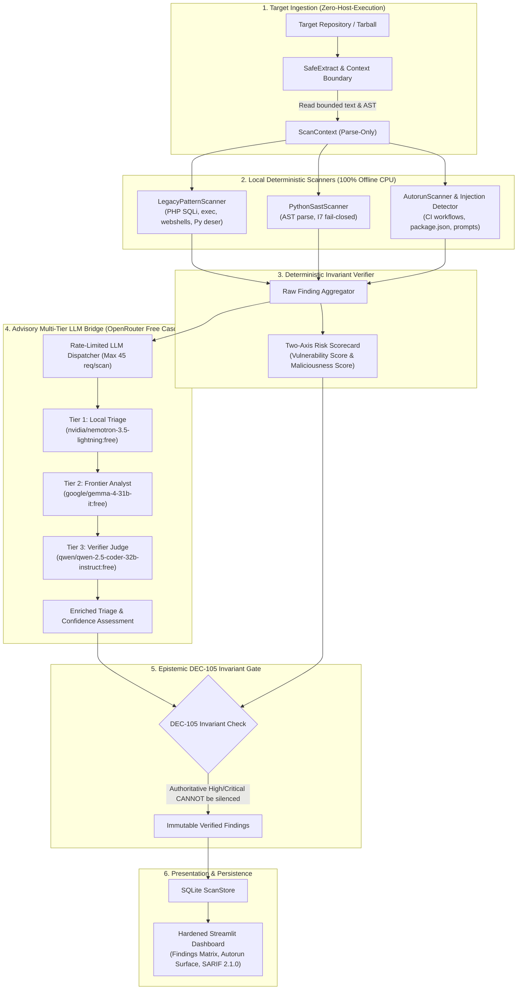

# AgentPOI-Scan: Zero-Host-Execution Static Vulnerability & Malicious Code Scanner

## 1. Architectural Overview

**AgentPOI-Scan** is a production-grade, zero-host-execution security analysis platform designed to inspect untrusted open-source and agentic software repositories for supply-chain backdoors, hidden autorun execution vectors, and software vulnerabilities.

Unlike conventional dynamic analyzers or VM-based sandboxes (e.g., Anthropic `oss-scanner`), AgentPOI-Scan enforces an absolute **Zero Host Execution Invariant**: target repositories are never executed, compiled, installed, or imported. All analysis executes via pure static analysis (regular expressions, AST decomposition, and metadata verification) augmented by an advisory multi-tier open-weight model cascade.

---

## 2. Threat Model & Invariant Guarantees

### 2.1 Threat Model
AgentPOI-Scan addresses five primary threat categories in untrusted repositories:
1. **Supply-Chain WebShells & Backdoors**: Obfuscated PHP/Python code that dynamically evaluates user input (`eval`, `base64_decode`, `create_function`, `$func($_POST)`).
2. **Hidden Autorun Surfaces**: Lifecycle scripts (`package.json` `postinstall`), IDE configuration tasks (`.vscode/tasks.json` with `folderOpen`), and privileged CI/CD workflows (`pull_request_target`).
3. **Insecure Deserialization**: Insecure loading of object streams (`pickle.loads`, `shelve.open`, `yaml.unsafe_load`, `torch.load` missing `weights_only=True`).
4. **Indirect Prompt Injection**: Hidden prompt injection directives in repository system prompts or code comments aimed at hijacking downstream agentic workers.
5. **Classic Injection Vulnerabilities**: SQL injection (`mysqli_query`, `$pdo->query`) and unescaped shell execution (`exec`, `system`, `passthru`, backticks).

### 2.2 Formal Invariant Guarantees
- **Zero Host Execution**: Target repository code is never imported, compiled, or executed on the host system.
- **Fail-Closed Parser (I7)**: Files that fail parsing (e.g., `SyntaxError`) are flagged as potential evasion vectors rather than silently skipped.
- **DEC-105 Veto Resistance**: High or Critical severity findings emitted by deterministic scanners cannot be silenced or downgraded by LLM triage alone (honeypot flip rate = 0%).
- **Non-Diluting Two-Axis Risk Scoring (DEC-106)**: Repository risk is computed as a severity-weighted maximum across findings rather than an average, preventing attackers from diluting a backdoor inside thousands of benign files.

---

## 3. Core Subsystems

### 3.1 Local Deterministic Scanners
- **`LegacyPatternScanner`** (`agentpoi_scan/scan/legacy_patterns.py`):
  - Detects PHP SQL injection, unescaped shell commands, and unsafe object deserialization.
  - Multi-line buffer scanning preserves exact 1-indexed line numbers across split statements.
  - Negative lookbehind regexes (`(?<!:)//.*$`) preserve valid URLs in command arguments while stripping inline comments.
- **`PythonSastScanner`** (`agentpoi_scan/scan/python_sast.py`):
  - Traverses the Python AST to identify dangerous function calls, dynamic code execution, and unverified imports.
- **`AutorunScanner`** (`agentpoi_scan/scan/autorun.py`):
  - Flags automated execution hooks in CI/CD configurations, Node.js packages, and editor workspace tasks.
  - Analyzes Markdown documents and docstrings for prompt injection patterns.

### 3.2 Advisory Multi-Tier LLM Bridge
The platform wires non-frontier open-weight models via OpenRouter's `:free` endpoints:
- **Tier 1 (Triage)**: `nvidia/nemotron-3.5-lightning:free` (cap: 20 req/scan)
- **Tier 2 (Frontier Analyst)**: `google/gemma-4-31b-it:free` (cap: 15 req/scan)
- **Tier 3 (Verifier Judge)**: `qwen/qwen-2.5-coder-32b-instruct:free` (cap: 10 req/scan)

A rolling window rate limiter restricts consumption to a maximum of 45 requests per scan. Credential patterns and sensitive files (`.env*`, `*.pem`, `*.key`) are automatically redacted prior to dispatch.

### 3.3 Hardened Streamlit Dashboard
The interactive user interface (`agentpoi_scan/ui/dashboard.py`) features 4 dedicated operational tabs:
1. **Findings Matrix**: Multi-attribute filtering (Severity, Category, Scanner, Free-text search) with code snippet inspection.
2. **Autorun Surface**: Inspection of repository execution vectors (CI pipelines, hooks, startup tasks).
3. **Category Breakdown**: Two-axis risk scorecards, metric counters, and category distribution.
4. **SARIF Export**: Standard SARIF 2.1.0 output for GitHub Security tab integration.

**Stored XSS Defenses**: All code snippets, file paths, and finding titles are sanitized via `html.escape(..., quote=True)` and rendered exclusively via `st.code()` or plain text.

---

## 4. Verification & Testing Standards

All features are tested against synthetic fixtures and adversarial test harnesses:
- **Legacy PHP Suite**: `tests/fixtures/legacy_php_repo/`
- **Agentic Snapshot Suite**: `tests/fixtures/langflow_snapshot/`
- **Unit & Stress Regression**: 191 automated scan tests executing in under 60 seconds with 100% pass rate.
- **Pre-Flight CI Pipeline**: Formally integrated into `scripts/ci_check.py` ensuring zero hardcoded secrets and zero syntax errors.
