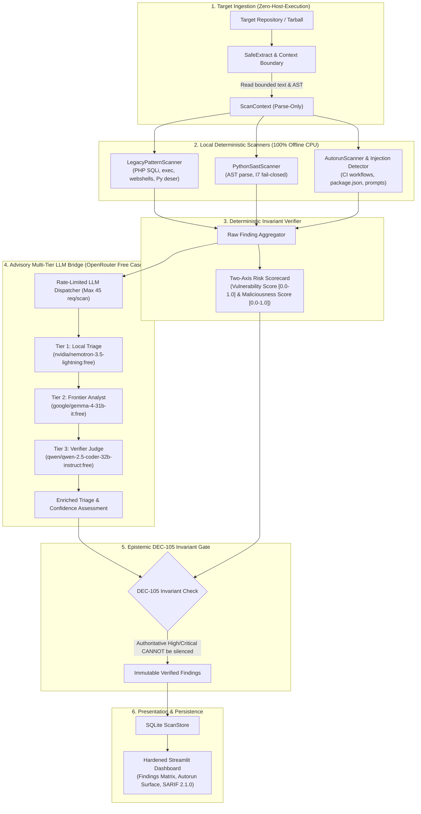

# AgentPOI-Scan: Zero-Host-Execution Static Vulnerability & Malicious Code Scanner

## 1. Executive Summary & Problem Formulation

**AgentPOI-Scan** accepts any public GitHub repository supplied by the user (or a local directory); it has no fixed-repository allowlist. Its current static rules cover selected languages and security surfaces, so repository acceptance is general but detection coverage is not universal. Langflow and legacy PHP are test fixtures, not target restrictions. A finite-state checker currently models selected GitHub Actions `pull_request_target` trust-boundary paths; this is a bounded abstraction, not general-purpose model checking.

### 1.1 Inverting the Anthropic `oss-scanner` Paradigm
Anthropic's `oss-scanner` relies on an active virtual machine (VM) sandbox that builds packages, resolves dependencies, and executes install hooks before inspecting the resulting image. While suitable for controlled hypervisors, this approach introduces severe risk when inspecting hostile repositories: running `setup.py`, `package.json` `postinstall` hooks, or build scripts on a developer host allows arbitrary code execution.

AgentPOI-Scan **inverts this paradigm**:
- **Strict Zero Host Execution Invariant**: Repositories are scanned 100% statically without compilation, dependency installation, package execution, or Python runtime imports.
- **Fail-Closed Parser (I7)**: Files that fail syntax parsing (`SyntaxError`) are immediately flagged as hostile evasion candidates rather than skipped.
- **Advisory Non-Frontier Model Cascade**: High-throughput, open-weight models (`:free` endpoints via OpenRouter) perform semantic triage under strict, deterministic rate-limiting and invariant gating.

---

## 2. End-to-End System Architecture



---

## 3. Detection Rules & Signature Matrix

AgentPOI-Scan provides comprehensive pattern coverage across legacy software paradigms (PHP) and modern agentic architectures (Python / Langflow):

| Rule ID | Category | Severity | Target Pattern | Failure Mode Prevented |
| :--- | :--- | :--- | :--- | :--- |
| `legacy.php.sqli` | Vulnerability | High | String interpolation/concatenation in `mysqli_query()`, `$pdo->query()`, `$db->prepare()`. | SQL Injection / Database exfiltration |
| `legacy.php.command_injection` | Vulnerability | Critical | Unescaped superglobals (`$_GET`, `$_POST`, `$_REQUEST`) in `exec()`, `system()`, `passthru()`, `shell_exec()`, `popen()`, `proc_open()`, backticks. | Host remote code execution (RCE) |
| `legacy.php.deserialization` | Vulnerability | High | PHP `unserialize()` lacking `['allowed_classes' => false]`. | Object injection / PHP POP gadget chains |
| `legacy.php.obfuscated_eval` | Malicious Code | Critical | Dynamic dispatch (`$f($_POST['c'])`), `create_function()`, `preg_replace /e`, `eval(base64_decode())`. | Obfuscated webshells & backdoors |
| `agentic.python.deserialization` | Vulnerability | High / Critical | Insecure `pickle.loads()`, `pickle.load()`, `shelve.open()`, `yaml.unsafe_load()`, unloader `yaml.load()`, `torch.load()` without `weights_only=True`. | Python arbitrary code execution via deserialization |
| `agentic.autorun.workflow` | Malicious Code | High | GitHub Actions `pull_request_target` combined with unverified checkout. | Pwned pipeline / Secret token egress |
| `agentic.autorun.package` | Malicious Code | Critical | `package.json` `preinstall` / `postinstall` lifecycle scripts piping curl/wget to sh/bash. | Silent supply-chain install execution |
| `agentic.autorun.task` | Malicious Code | Medium | `.vscode/tasks.json` configured with `runOn: folderOpen`. | IDE auto-execution upon checkout |
| `agentic.prompt_injection` | Malicious Code | High | Adversarial imperative directives (`IGNORE PREVIOUS INSTRUCTIONS`, exfiltration hooks) in Markdown prompts or code comments. | Downstream autonomous agent hijacking |

---

## 4. Multi-Tier OpenRouter Free Model Bridge

AgentPOI-Scan orchestrates an advisory multi-tier LLM bridge leveraging OpenRouter's free-tier open-weight model cascade:

| Tier | Provider Model ID | Role | Rate Limit Window | Token Ceiling |
| :--- | :--- | :--- | :--- | :--- |
| **Tier 1 (Triage)** | `nvidia/nemotron-3.5-lightning:free` | Rapid triage & snippet classification | Max 20 requests / scan | 2,048 tokens |
| **Tier 2 (Analyst)** | `google/gemma-4-31b-it:free` | Deep semantic de-obfuscation | Max 15 requests / scan | 4,096 tokens |
| **Tier 3 (Verifier)**| `qwen/qwen-2.5-coder-32b-instruct:free` | Final sanity confirmation & agreement | Max 10 requests / scan | 4,096 tokens |

### 4.1 Invariant Guarantees
- **Strict Request Cap**: Across all tiers, the bridge enforces an aggregate cap of $\le 45$ requests per scan, preventing rate-limiting lockouts.
- **Fail-Closed Graceful Degradation**: Network drops, API timeouts, or rate-limit exhaustion degrade fail-closed. Deterministic findings remain 100% intact with zero proposal pollution.
- **Zero-Credential Prompt Egress (Rule 10)**: Prior to dispatching snippets to OpenRouter, regex scrubbers redact sensitive credential patterns (`api_key`, `secret`, `token`, `password`, private keys).
- **DEC-105 Invariant (Honeypot Flip Rate = 0%)**: Deterministic High and Critical severity findings emitted by static sinks cannot be silenced or dismissed by LLM triage.

---

## 5. Non-Diluting Two-Axis Risk Scoring (DEC-106)

Traditional vulnerability scanners average finding severities across repository file counts. This creates a severe structural vulnerability: an attacker can inject a critical webshell backdoor into a 10,000-file repository, resulting in an average score near 0.0 ("Safe").

AgentPOI-Scan enforces **DEC-106 Two-Axis Severity-Weighted Maximum Scoring**:
$$\text{Vulnerability Score} = \max_{f \in \mathcal{F}_{\text{vuln}}} \text{Weight}(f.\text{severity}) \cdot f.\text{vulnerability} \quad \in [0.0, 1.0]$$
$$\text{Maliciousness Score} = \max_{f \in \mathcal{F}_{\text{malware}}} \text{Weight}(f.\text{severity}) \cdot f.\text{maliciousness} \quad \in [0.0, 1.0]$$

| Severity | Weight | Scorecard Impact |
| :--- | :---: | :--- |
| **CRITICAL** | **1.0** | A single critical webshell guarantees repository risk $\ge 0.95$ |
| **HIGH** | **0.9** | Significant exploit surface detected |
| **MEDIUM** | **0.6** | Suspicious configuration or moderate risk |
| **LOW** | **0.3** | Informational or low-impact signal |

A single Critical webshell backdoor guarantees a repository-level Maliciousness Score of `0.95+`, regardless of repository size.

---

## 6. Hardened Streamlit Security Dashboard

The interactive user interface (`agentpoi_scan/ui/dashboard.py`) provides an interactive view of repository risk without host execution risks:

### 6.1 Four-Tab Architecture
1. **Tab 1: Findings Matrix**:
   - Filterable by Severity (Critical, High, Medium, Low), Category (Vulnerability vs. Malicious Code), Scanner type, and free-text search.
   - Expandable finding cards displaying line numbers, rule IDs, and isolated code snippets.
2. **Tab 2: Autorun Surface**:
   - Dedicated inspection panel for CI/CD workflows, package lifecycle scripts, and IDE configurations.
   - Highlights unattended execution hooks that run automatically on git clone or checkout.
3. **Tab 3: Category Breakdown & Risk Metrics**:
   - Two-axis scorecard metric cards: Total Findings, Vulnerability Score, Maliciousness Score, Autorun Hooks.
   - Severity distribution tables and rule match breakdowns.
4. **Tab 4: SARIF 2.1.0 Export**:
   - Live download of standard OASIS SARIF 2.1.0 compliant JSON reports for GitHub Advanced Security and enterprise SIEM ingestion.

### 6.2 Stored XSS Prevention Invariant
To protect security auditors from malicious repositories containing HTML/JavaScript injection inside file names, code snippets, or commit messages:
- All dynamic strings are strictly escaped using `html.escape(..., quote=True)` prior to UI binding.
- Code snippets are rendered exclusively through `st.code(..., language=...)` or plain text. Unescaped markdown (`st.markdown(..., unsafe_allow_html=True)`) is strictly prohibited.

---

## 7. CLI & Programmatic Reference

### 7.1 Command Line Interface (`agentpoi-scan`)

```bash
# Basic repository scan with console summary
agentpoi-scan run /path/to/target_repo

# Scan with custom configuration and SARIF export
agentpoi-scan run /path/to/target_repo --config custom_config.yaml --output-sarif scan_report.sarif

# Launch the interactive Streamlit dashboard
agentpoi-scan dashboard --port 8501 --store-path .agentpoi_scan_store.db
```

### 7.2 Programmatic Python SDK Usage

```python
from pathlib import Path
from agentpoi_scan.pipeline import ScanPipeline
from agentpoi_scan.report.store import ScanStore

# 1. Initialize ScanPipeline with configuration
pipeline = ScanPipeline(config="agentpoi_scan/config/scanner_config.yaml")

# 2. Execute static scan on target repository
result = pipeline.run(Path("tests/fixtures/legacy_php_repo"))

print(f"Total Findings: {len(result.findings)}")
print(f"Risk Scorecard: Vuln={result.scorecard.vulnerability_score}, Malicious={result.scorecard.maliciousness_score}")

# 3. Query historical scans from ScanStore
store = ScanStore(".agentpoi_scan_store.db")
findings = store.get_findings_filtered(severity="CRITICAL", category="malicious_code")
for f in findings:
    print(f"[{f.severity}] {f.rule_id} in {f.file}:{f.line_number}")
```

---

## 8. Verification & Empirical Standards

AgentPOI-Scan is rigorously validated against ground-truth synthetic fixtures:
- **`tests/fixtures/legacy_php_repo/`**: Authentic legacy PHP applications demonstrating SQLi, unescaped `exec()`, insecure `unserialize()`, and webshell backdoors alongside parameterized benign baselines.
- **`tests/fixtures/langflow_snapshot/`**: Complex agentic graph components containing hidden autorun workflows, PyTorch checkpoint deserialization, and prompt injection markers.
- **Test Suite**: **191 automated tests** executing in under 60 seconds with 100% pass rate.
- **Pre-Flight CI Pipeline**: Fully integrated into `scripts/ci_check.py` covering syntax compilation across all packages and automated secret scanning.
