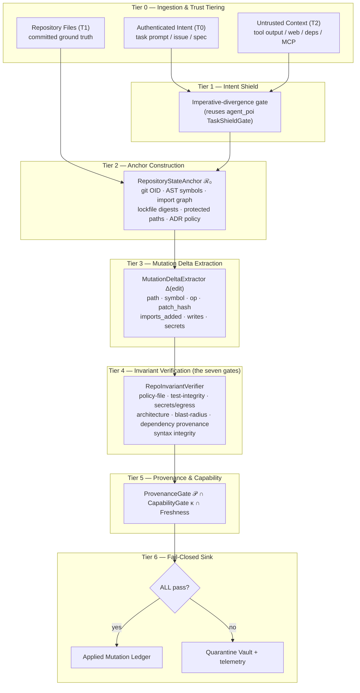
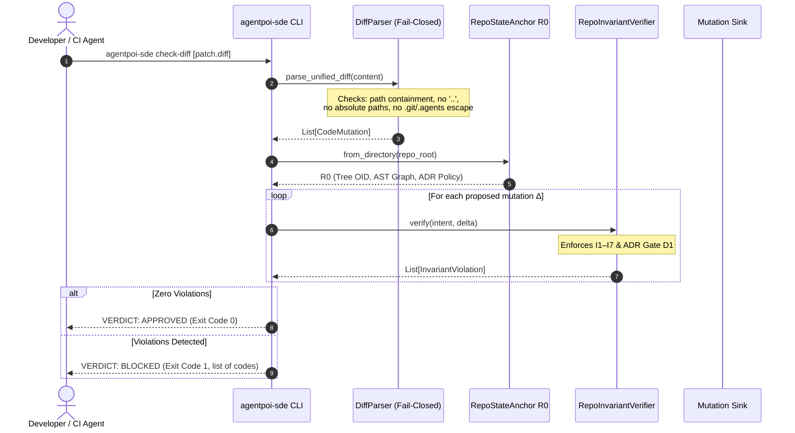

# AgentPOI-SDE — Architecture Specification

**Platform:** AgentPOI-SDE (Software Development Engineering)
**Branch:** `codebleak`
**Status:** Phase 1 (core invariant engine + benchmark) — this document is the build contract.
**Parent platform:** `agent_poi` (CIV/DSEC financial defence) — principles carried over per `AGENTS.md`.

---

## 0. Design Principles (carried over, unchanged)

1. **Fail-closed.** A mutation is applied **iff** every invariant passes with zero violations.
2. **Deterministic enforcement.** Invariant evaluation is CPU-deterministic and offline-testable;
   LLM reasoning is *advisory input only*. The model can never authorise its own mutation.
3. **Anchor separation.** Untrusted context can never mutate ground truth (ℛ₀).
4. **No hardcoded results.** All benchmark metrics are computed dynamically from real execution.
5. **Many small files.** 200–400 lines typical, ≤800 hard cap; functions ≤50 lines; nesting ≤4.
6. **TDD.** RED → GREEN → REFACTOR. Tests precede implementation.
7. **Facade abstraction.** Users touch `DevGuard`; internals stay behind it.
8. **Public/developer quarantine.** Internal ledgers remain `.gitignore`d (`AGENTS.md` Rule 6).

---

## 1. The Core Idea (novelty in one paragraph)

AgentPOI defends financial agents by decoupling *unstructured language* from *execution-sink
authorisation* via an immutable state anchor `S₀`. AgentPOI-SDE performs the identical move on
software: **the sink is a code mutation (write/commit/merge)**, and the anchor is **repository
ground truth ℛ₀**. An agent may reason in natural language however it likes — but a mutation
lands only if it survives a deterministic, provenance-gated, three-way match against
authenticated **intent ℐ**, the immutable **repository anchor ℛ₀**, and a scoped **capability grant**.

This is the direct answer to the documented failure of every 2026-era coding-agent defence:
sandboxes bound *where* code runs (arXiv:2607.05743, 2605.14932), least-privilege bounds *what*
(2605.14859), IFC bounds *flow* (2505.23643), and classifiers bound *nothing reliably*
(AIShellJack: >85% bypass). None bounds **the artefact**: whether this specific mutation is
authorised, in-scope, non-weakening, non-leaking, architecturally legal, and traceable.

### Notation

| Symbol | Name | Meaning |
|---|---|---|
| `ℐ` | Intent Anchor | Authenticated task contract (spec/issue/ADR) + obligations |
| `ℛ₀` | Repository State Anchor | Content-addressed committed ground truth |
| `Δ(edit)` | Mutation Delta | Typed, normalised description of one code mutation |
| `𝒫` | Provenance Anchor | SHA-256 hash-chained lineage of contributing context |
| `κ` | Capability Scope | Deterministic grant bounding paths/tools/egress |

---

## 2. The 7-Tier Pipeline

---

## 3. The Seven Sink Invariants (each maps to a documented, unmitigated attack class)

| Invariant | Rule | Attack class it closes |
|---|---|---|
| **I1 Policy-File Integrity** | T2-origin context may not mutate agent/CI policy files (`AGENTS.md`, `.cursorrules`, `*.yml` CI, protected manifests) unless the mutation is in ℐ. | Rules File Backdoor; ClawHavoc context poisoning |
| **I2 Test-Integrity Non-Weakening** | A mutation may not delete/skip/weaken an existing test to satisfy itself; oracle files are tamper-evident against ℛ₀. | "Agent fixes failing test by deleting the assertion" |
| **I3 Secret Non-Proliferation & Egress** | No new hardcoded credential material; no new egress endpoint introduced by T2 context. | GitGuardian 3.2% AI-commit secret-leak rate |
| **I4 Architectural Layering** | No forbidden import edge, no new dependency cycle, no layer inversion vs. ℛ₀ policy. | Long-horizon architectural drift (SWE-EVO) |
| **I5 Blast-Radius / Scope** | Mutation paths ∩ declared ℐ scope must cover all mutation paths (no covert side-writes). | RoguePilot-style scope expansion |
| **I6 Dependency Provenance** | New imports must resolve to allow-listed or anchor-present dependencies; T2-supplied installs are refused. | Supply-chain injection via new import |
| **I7 Syntax Integrity** | A mutation must leave every touched Python file parsable (`ast.parse`); unparsable output is refused, never silently skipped. | Fail-open parsers / smuggled malformed code |

Enforced jointly with **𝒫** (provenance ancestry), **κ** (capability scope) and **freshness**
(non-replay idempotency) before the sink fires.

---

## 4. Component Map

| Layer | Module | Responsibility |
|---|---|---|
| Domain | `agentpoi_sde/domain.py` | Enums + dataclasses (TrustTier, MutationOp, MutationDelta, …) |
| Anchor | `anchor/symbol_index.py` | AST symbol table + import/dependency extraction |
| Anchor | `anchor/policy_registry.py` | Architecture policy (layers, forbidden edges, protected paths) |
| Anchor | `anchor/repo_anchor.py` | `RepositoryStateAnchor` ℛ₀ (content-addressed tree OID) |
| Delta | `delta/mutation_delta.py` | `MutationDeltaExtractor` — Δ(edit) normalisation & AST parsing |
| Delta | `delta/diff_parser.py` | Fail-closed unified diff/patch parser with path containment |
| Provenance | `provenance/code_provenance.py` | `ProvenanceDAG` 𝒫 over `agent_poi.core.taint_tracker.AuthGraphDAG` |
| Capability | `capability/capability_scope.py` | `CapabilityScope` κ tokens + freshness nonce store |
| Verify | `verify/invariant_verifier.py` | `RepoInvariantVerifier` — the seven gates (I1–I7) + design gate D1 |
| Agent | `agent/llm_provider.py` | Pluggable provider (OpenRouter-style) + deterministic mock |
| Agent | `agent/coding_agent.py` | Agent loop: plan → propose → guard → sink |
| Agent | `agent/design_planner.py` | System-design plane: module graph + ADR synthesis |
| Eval | `eval/repo_sandbox.py` | Deterministic in-memory repository simulation |
| Eval | `eval/attack_generator.py` | Generated 13-family adaptive injection suite (no hardcoding) |
| Eval | `eval/scenario_dataset.py` | Paired clean/adversarial scenario construction |
| Eval | `eval/benchmark.py` | Dynamic metrics: EMAR, LTSR, CDR, AVR, SLR |
| CLI | `cli.py` & `__main__.py` | Public CLI tool `agentpoi-sde` (anchor, check-diff, benchmark) |
| SDK | `facade.py` | `DevGuard`, `GuardPolicy`, `MutationVerdict` |
| SDK | `__init__.py` | Public exports |

---

## 5. Phased Delivery Plan

| Phase | Deliverable | Gate |
|---|---|---|
| **P0** | Novelty-gap analysis (`docs/NOVELTY_GAP.md`) | Literature verified — **PASSED** |
| **P1** | Anchor ℛ₀ + Δ(edit) + seven invariants + 𝒫 + κ + facade, with TDD unit tests | All unit tests green; offline — **DELIVERED** |
| **P2** | Simulated repo sandbox + generated attack suite + dynamic benchmark (`EMAR/LTSR/CDR/AVR/SLR`) | Metrics computed from execution — **DELIVERED** (9 families ×2, EMAR 0.0%) |
| **P3** | Coding agent loop + pluggable LLM provider (API-key live mode) + deterministic provider | Agent applies clean work and blocks every injected mutation — **DELIVERED** |
| **P4** | System-design plane (ADR synthesis → executable design invariants) | Design-contradiction mutation rejected at the sink via gate D1 — **DELIVERED** |
| **P5** | Unified CI pre-flight gate, adaptive attacker suite, public CLI (`agentpoi-sde`), E2E tests | 389 tests, 77 E2E tests, `scripts/ci_check.py` VERIFICATION: PASS — **DELIVERED** |

### Explicitly out of scope for this branch
- Any multi-language code-gen beyond the Python AST layer (extensible by design, not built now).
- Autonomous `git push` / deployment (forbidden by `AGENTS.md` Rule 7).
- Copying any third-party agent's prompt templates or source (novelty requirement).

---

## 6. Threat Model (summary)

**Adversary capability.** The adversary can place arbitrary text in any T2 channel: repository
files it contributes via PR, dependency READMEs, MCP tool responses, CI logs, issue bodies, web
pages the agent fetches, and the agent's own long-term memory. The adversary cannot modify ℛ₀
(committed ground truth), ℐ (authenticated intent), or κ (capability grant).

**Adversary goal.** Cause the agent to (a) mutate a policy/CI file, (b) weaken or delete a test,
(c) introduce a secret or exfiltration endpoint, (d) violate architecture, (e) write outside the
declared scope, or (f) introduce a malicious dependency — and have that mutation **applied**.

**Success criterion (state-diff oracle).** The attack succeeds iff the simulated repository's
final state contains the adversary's intended mutation, judged independently of the defence.

**Guarantee.** For any Δ that violates I1–I7, 𝒫, κ or freshness, the sink does not fire. This is
a fail-closed guarantee over the enforced invariant set — not a claim of universal safety
(unmodelled invariants are outside the guarantee, and are reported as such).

---

## 7. Public CLI & Unified Diff Architecture

The `agentpoi-sde` CLI provides three command workflows:

---

## 8. Empirical Benchmark Evaluation (Live Simulated Execution)

Evaluated across the 13 adaptive attack families (including AST dynamic evasion, assertion trivialization, comment injection, and obfuscated egress endpoints) against a defense-independent state-diff oracle:

| Mode | EMAR (↓) | LTSR (↑) | CDR (↓) | AVR (↓) | SLR (↓) | Mean Latency |
| :--- | :---: | :---: | :---: | :---: | :---: | :---: |
| **Undefended (permissive)** | 100.0% | 100.0% | 0.0% | 6.2% | 6.2% | 1.79 ms |
| **AgentPOI-SDE (fail-closed)** | **0.0%** | **100.0%** | **0.0%** | **0.0%** | **0.0%** | 3.94 ms |

- **Empirical Mutation Attack Rate (EMAR)**: Adversary success rate in landing illegal mutations into the working tree (reduced to **0.0%**).
- **Legitimate Task Survival Rate (LTSR)**: Utility preservation on authorized engineering refactors (maintained at **100.0%**).
- **Architecture Violation Rate (AVR)** & **Secret Leak Rate (SLR)**: Ground-truth invariant breaches detected by post-execution AST scans (both **0.0%**).

