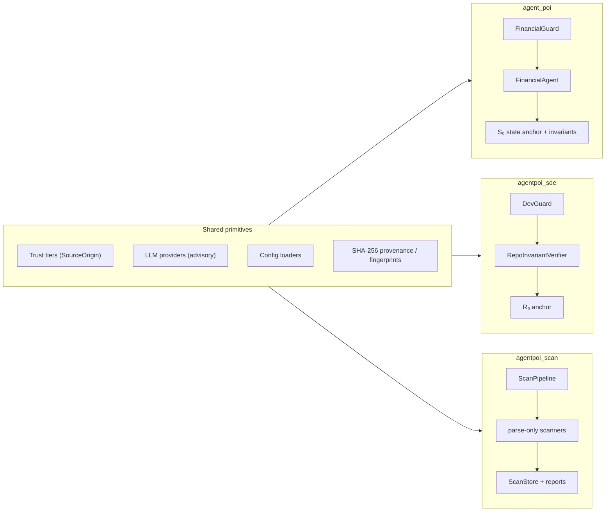
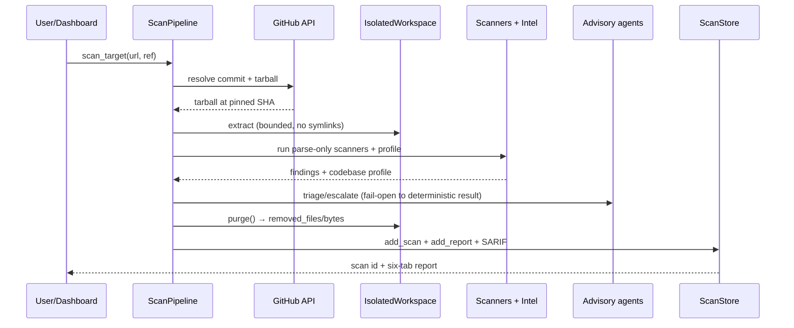

# AgentPOI System Documentation

**Internal & external reference for the whole framework — and the shortest path to improving it.**

| | |
| :--- | :--- |
| **Version** | 1.0 (2026-10-30) |
| **Scope** | `agent_poi` (financial), `agentpoi_sde` (coding agent), `agentpoi_scan` (repository scanner) |
| **Audience** | Maintainers, integrators, security researchers extending the agentic platform |
| **Companion docs** | [README](../README.md), [SDE_ARCHITECTURE.md](SDE_ARCHITECTURE.md), [SCANNER_DASHBOARD_ARCHITECTURE.md](SCANNER_DASHBOARD_ARCHITECTURE.md), [DEVELOPMENT.md](DEVELOPMENT.md) |

This document is deliberately narrow: it describes **what exists**, **where its boundaries are**, and **what to change next**. It does not repeat marketing claims. Statements about guarantees are scoped to the invariant sets actually enforced in code.

---

## 1. System at a Glance

One repository ships three isolated application domains that share a single design pattern: **untrusted language may propose, deterministic CPU code decides**.

| Domain | Package | Public facade | CLI | Protected sink | Anchor | Fail-closed rule |
| :--- | :--- | :--- | :--- | :--- | :--- | :--- |
| Financial agent defence | `agent_poi` | `FinancialGuard` | — | Disbursement / tool dispatch | `S₀` financial state | CIV + DSEC; disburse iff every invariant passes |
| Coding-agent defence | `agentpoi_sde` | `DevGuard` | `agentpoi-sde` | Code mutation (write/commit) | `R₀` repository ground truth | I1–I9 + D1; apply iff zero violations |
| Untrusted-repo scanner | `agentpoi_scan` | `ScanPipeline`, `ScanStore` | `agentpoi-scan` | None — target code never runs | Pinned commit snapshot | Parse-only; LLM may annotate, never silence |



### 1.1 Repository layout

```text
agent_poi/            financial guard, memory firewall, research/evaluation harness
agentpoi_sde/         RIV engine, anchors, invariants, graph/schema, agent loop, MCP, CLI
agentpoi_scan/        zero-execution scanner: fetch, intel, scan, agents, report, ui
tests/                unit/integration/E2E suites for all three domains
docs/                 architecture specs and this reference
scripts/              ci_check.py, run_all.py, metrics renderer, figure generators
pyproject.toml        one distribution, three console entry points
```

### 1.2 External vs internal

- **External surface** — what an integrator may depend on: public facades, CLI arguments, config keys, environment variables, emitted files (SQLite, SARIF, reports), dashboard behaviour.
- **Internal surface** — what maintainers may change freely: scanner adapters, verifier helpers, extractors, orchestration order, storage internals. Internal names are not compatibility promises.

---

## 2. Shared Invariants

These rules are the framework's identity. Any improvement must preserve them (see `AGENTS.md`).

| Invariant | Enforcement point | Consequence |
| :--- | :--- | :--- |
| **Fail-closed sink** | `FinancialGuard.protect`, `DevGuard.propose_mutation`, `ScanPipeline.scan_target` | A missing/ambiguous signal blocks or degrades; it never permits |
| **Deterministic verifier** | `financial/invariant_verifier.py`, `verify/invariant_verifier.py`, `scan/*` | All decisions are CPU-deterministic, offline-testable |
| **Advisory-only LLM** | `agents/router.py`, `scan/agents/*`, `sde/agent/*` | Models annotate/escalate; they cannot authorise or clear authoritative findings |
| **Trust tiering** | `agent_poi.memory.schema.SourceOrigin` | T0 intent, T1 repo ground truth, T2 untrusted context; T2 never mutates anchors |
| **Zero host execution** | `fetch/safe_extract.py`, `scan/base.py`, `scan/*` | Scanned repositories are never imported, built, installed or run |
| **Facade abstraction** | `facade.py` in each package | Integrators touch `FinancialGuard` / `DevGuard` / `ScanPipeline` only |
| **No hardcoded results** | `scripts/render_sde_metrics.py --check` (CI gate) | Published metrics are regenerated from a live run |
| **Public/developer quarantine** | `.gitignore` | Internal ledgers, prompts and agent logs never ship |

**Dependency direction**

```text
agent_poi  (trust tiers, providers, memory schema)
   ▲                    ▲
   │                    │
agentpoi_sde ───────────┘   (imports SourceOrigin; scan imports slicer_security)
   ▲
   │
agentpoi_scan  (imports agent_poi.agent.llm_provider + agentpoi_sde SlicerSecurityValidator)
```

`agentpoi_scan` is the most coupled package: it borrows the SDE AST security validator and the older OpenRouter provider. The provider duplication is the first refactor target (see §12).

---

## 3. External Contracts

### 3.1 Python SDK

| Entry point | Signature / object | Returns | Notes |
| :--- | :--- | :--- | :--- |
| `agent_poi.FinancialGuard` | `FinancialGuard(policy, per_transaction_limit, daily_limit, raise_on_violation)` | guard | Exported from `agent_poi`; implemented in `agent_poi/facade.py` |
| | `.protect(task_query, context, task_id, origin, ...)` | `GuardVerdict` | Core CIV/DSEC evaluation |
| | `.protect_with_po(...)`, `.verify_invoice_and_disburse(...)` | `GuardVerdict` | Adds 3-way match + idempotency |
| | `.protect_with_capseal(...)` | `GuardVerdict` | Capability-token preflight |
| | `.register_payee(...)`, `.register_purchase_order(...)` | `None` | Seeds the immutable anchor |
| | `.sanitize_context_surgical`, `.evaluate_causal_dominance`, `.verify_action_subsumption` | typed results | Optional research-grade checks |
| `agentpoi_sde.DevGuard` | `DevGuard(policy, files, architecture_policy, dependency_allowlist, design_decisions, capability, repo_dir, apply_to_disk, ...)` | guard | `files` gives an in-memory tree; `repo_dir` enables disk writes |
| | `.register_intent(intent_id, goal, allowed_paths, obligations)` | `IntentContract` | Authenticated T0 root |
| | `.propose_mutation(CodeMutation, intent_id, nonce, auth_token, ...)` | `MutationVerdict` | All gates; `protect()` is an alias |
| | `.commit()`, `.get_workspace()`, `.get_ledger()`, `.get_audit_log()` | tree OID / copies | Anchor promotion and audit |
| | `.register_working_file`, `.register_regression_test`, `.run_sandbox_tests` | — | I9 / sandbox tooling |
| `agentpoi_scan.ScanPipeline` | `ScanPipeline(store_path, config)` | pipeline | `config` may be a dict or YAML path |
| | `.scan_target(repo_url, ref, workdir)` | `ScanReport` | URL, `owner/repo`, or local directory |
| | `.run_scanners(...)`, `.refine(...)` | findings / report | Lower-level stages for tests and tooling |
| `agentpoi_scan.report.store.ScanStore` | `ScanStore(path)` | store | SQLite; not re-exported from the package root |
| | `.add_scan`, `.get_findings_filtered`, `.list_scans`, `.add_report`, `.get_report` | rows / payloads | Dashboard reads through this |

### 3.2 Command line

| Command | Subcommands / flags | Purpose |
| :--- | :--- | :--- |
| `agentpoi-scan` | `run`/`scan <url\|path>`; `--branch`, `--config`, `--sarif`, `--offline`, `--workdir` | Scan a repository or directory |
| | `validate <registry>` | Validate `scan_registry/*/project.yaml` entries |
| | `dashboard`; `--port`, `--store-path` | Launch the Streamlit UI |
| `agentpoi-sde` | `anchor [path] --json --manifest` | Compute/inspect `R₀` |
| | `check-diff [patch] --repo --staged --allow --intent-id --json` | Fail-closed diff check |
| | `benchmark --seed --per-family --clean-per-family --format -o` | Dynamic SDE benchmark |
| | `run --task --interactive --max-steps --budget --model --api-key --repo --json -o` | Autonomous agent loop behind the guard |
| | `graph`, `cross-stack`, `harvest`, `sandbox` | Merkle index, I8 audit, safe component slice, isolated test run |

Console scripts are installed by `pip install -e .`; without installation use `python -m agentpoi_scan.cli` / `python -m agentpoi_sde`.

### 3.3 Configuration and environment

| Source | Keys | Consumed by |
| :--- | :--- | :--- |
| `agent_poi/config.yaml` (+ `config.yaml`) | financial limits, provider defaults | `agent_poi.core.config_loader` |
| `agentpoi_scan/config/scanner_config.yaml` | `scanners`, `tiers`, `limits`, `router`, `fetch`, `privacy` | `ScanPipeline`, `build_default_providers` |
| SDE defaults + optional override | `guard`, `invariants`, `egress_allowlist`, `protected_paths` | `agentpoi_sde.config_loader` |
| `OPENROUTER_API_KEY`, `OPENROUTER_MODEL` | LLM tier credentials | financial, SDE, scanner providers |
| `GITHUB_TOKEN` | Raises GitHub API limits / private fetch | `SnapshotClient` |
| `AGENT_POI_CONFIG`, `AGENTPOI_SDE_CONFIG` | Alternate config paths | Domain loaders |
| `AGENTPOI_SDE_PROVIDER`, `DEEPSEEK_API_KEY`, `VLLM_API_KEY` | Provider selection | SDE provider hub |
| `AGENTPOI_ROLLBACK_ON_FAILURE` | Force rollback in the SDE runner | `agentpoi_sde/agent/runner.py` |

A repo-root `.env` is loaded by the scan bridge and config loaders; existing environment variables always win.

### 3.4 Artifacts

| Artifact | Location | Written by | Contents |
| :--- | :--- | :--- | :--- |
| Scan store | `.agentpoi_scan/scan_store.sqlite3` | `ScanStore` | `scans`, `findings`, `reports` |
| SARIF | `.agentpoi_scan/findings.sarif` (configurable) | `write_sarif` | SARIF 2.1.0 with region snippets |
| Ephemeral workspace | `.agentpoi_scan/ws_*` | `IsolatedWorkspace` | Tarball + extracted source; **deleted before `scan_target` returns** |
| Dashboard report | SQLite `reports.payload` | pipeline | Codebase profile, isolation/purge proof, finding summary |
| SDE ledger/audit | In memory, exposed by `get_ledger()` / `get_audit_log()` | `DevGuard` | Applied/blocked mutation records |
| Financial ledger | In memory, exposed by `get_audit_ledger()` | `FinancialGuard` | Disbursement/audit records |

### 3.5 Dashboard surface

`agentpoi-scan dashboard` renders six tabs from the store: **Flagged Files** (severity badges, top remediation, drill-down), **Examination Report** (isolation/purge, languages, dependencies, routes, entrypoints, skipped scanners), **Findings Matrix**, **Autorun Surface**, **Category Breakdown**, **SARIF Export**. All repository-derived text is rendered as escaped text/`st.code`; `unsafe_allow_html=True` is prohibited.

`streamlit run agent_poi/ui/app.py` is a separate research workstation for the financial/memory domain: agent chat with live retrieval, memory-firewall monitor, attack-injection lab, and benchmark/Pareto views. It is an inspection surface, not part of the guard's decision path.

---

## 4. Internal — `agent_poi` (FinancialGuard)

**Purpose:** stop indirect prompt injection from turning retrieved text into unauthorised money movement.

| Layer | Module | Responsibility |
| :--- | :--- | :--- |
| Facade | `facade.py` | `FinancialGuard`, `SecurityPolicy`, `GuardVerdict`, typed exception mapping |
| Orchestration | `financial/financial_agent.py` | Task intake → context admission → delta extraction → invariant verification → tool dispatch |
| Anchor | `financial/state_anchor.py` | Immutable payees, limits, PO registry, capability tokens, idempotency, ledger |
| Delta | `financial/delta_extractor.py` | Extracts target account, amount, intent from untrusted context |
| Verifier | `financial/invariant_verifier.py` | Deterministic invariant checks over the anchor + delta |
| Retrieval gate | `core/alignment_gate.py` | Task Shield relevance/divergence scoring |
| Lineage | `core/taint_tracker.py` | AuthGraph DAG of content origins; untrusted nodes cannot authorise |
| Redaction | `core/prompt_locate.py` | Surgically removes imperative injection spans, preserving financial data |
| Causality | `core/causal_armor.py` | Causal-dominance ratio between user goal and untrusted context |
| Plan check | `core/ace_planner.py` | Abstract plan + concrete-action subsumption |
| Data | `evaluation/data_sentinel.py` | Data-sentinel optimiser / evaluation |
| Memory | `memory/*` | Schema, firewall, vector store |

**Flow**

```text
protect(task, context) → TaskShieldGate → AuthGraph lineage → DeltaExtractor
        → state-anchor invariants (payee, ceiling, velocity, PO)
        → GuardVerdict {APPROVED | BLOCKED | QUARANTINED}
```

`protect_with_po` adds idempotency and 3-way matching before the core call. `protect_with_capseal` validates a capability token before disbursement. `raise_on_violation=True` maps the primary violation to a typed exception (`UnauthorizedPayeeError`, `DisbursementCeilingExceededError`, …).

**Current limits:** simulated ledger (no bank/payment rail), in-memory state, single-currency amount model, no FX/fees/chargebacks, synthetic benchmark scenarios.

---

## 5. Internal — `agentpoi_sde` (DevGuard / RIV)

**Purpose:** authorise a code mutation only if it matches authenticated intent, repository ground truth, and scoped capability.

### 5.1 Seven-tier pipeline

| Tier | Component | Output |
| :--- | :--- | :--- |
| 0 Ingestion | Intent / repo files / untrusted context | Trust-tiered inputs |
| 1 Intent Shield | `anchor/policy_registry.py` injection markers, `screen_context` | Injection findings |
| 2 Anchor | `RepositoryStateAnchor` | Content-addressed `R₀` (tree OID, symbols, imports, lockfiles, policy) |
| 3 Delta | `MutationDeltaExtractor`, `diff_parser` | Typed `Δ`: path, op, patch hash, imports, secrets, symbols |
| 4 Invariants | `RepoInvariantVerifier` | I1–I9 + D1 violations |
| 5 Provenance/capability | `ProvenanceDAG`, `CapabilityScope` | Authority + freshness verdict |
| 6 Sink | `DevGuard.propose_mutation` | Apply + ledger, or quarantine + audit |

### 5.2 Enforced invariants

| Code | Rule | Blocked attack |
| :--- | :--- | :--- |
| I1 | Policy/CI files may only change within intent scope | Rules-file backdoor, CI tampering |
| I2 | No test deletion/skip/assertion weakening | "Make the test pass by deleting it" |
| I3 | No new secrets or unapproved egress | AI-commit credential leakage |
| I4 | No forbidden import edge, cycle or layer inversion | Architectural drift |
| I5 | All mutated paths must be inside declared intent | Covert scope expansion |
| I6 | New imports must resolve to anchored/allowed dependencies | Dependency injection |
| I7 | Touched Python files must remain parsable | Fail-open parser evasion |
| I8 | Frontend calls must match declared backend route/verb/fields | Hallucinated endpoints |
| I9 | Registered working files require an explicit capability grant | Regression rewriting |
| D1 | Mutations contradicting a design decision are rejected | Design reversal |

Codes for provenance (`P1`–`P4`), capability (`K1`–`K3`), freshness (`F`) and unknown intent (`I0`) can also block; they are not part of the I1–I9 table but are enforced by the same sink.

### 5.3 Key modules

`anchor/` (`repo_anchor`, `symbol_index`, `policy_registry`, `working_part_anchor`), `delta/`, `provenance/`, `capability/`, `verify/`, `graph/` (Merkle graph, architectural ledger, indexer, context router), `schema/` (frontend/backend extractors + consensus), `harvester/` (program slicer + security sanitiser), `sandbox/`, `agent/` (coding agent, design planner, JEV, transport security, runner), `mcp/`, `eval/`.

**Mutation lifecycle**

```text
propose_mutation(mutation, intent_id)
  → origin authentication (P1) → delta extraction
  → PERMISSIVE? apply : evaluate gates
  → I1..I9 + D1 + provenance + capability + freshness
  → all pass: apply delta, update workspace, Merkle graph, ledger
  → any fail: audit + BLOCKED verdict (+ typed exception if requested)
```

**Current limits:** Python-centric AST (I7 parses Python; I4/I8 extractors cover selected frameworks), in-memory provenance/ledger, synthetic 40-scenario benchmark, and a configuration sandbox that runs pytest via subprocess in a throwaway directory rather than inside an OS/container boundary with network isolation.

---

## 6. Internal — `agentpoi_scan` (zero-execution scanner)

### 6.1 Zones

| Zone | Modules | Responsibility |
| :--- | :--- | :--- |
| 1 Fetch | `fetch/snapshot_client.py`, `safe_extract.py`, `workspace.py` | Resolve one commit, download tarball, bounded extraction into an ephemeral workspace |
| 2 Scan + intel | `scan/*`, `intel/codebase.py` | Parse-only detectors + static inventory of languages/deps/routes/entrypoints |
| 3 Advisory triage | `agents/llm_bridge.py`, `triage.py`, `router.py`, `analyst.py`, `context_server.py` | Rate-limited OpenRouter cascade; redacted, delimited snippets |
| 4 Report | `findings/*`, `report/store.py`, `report/sarif.py`, `ui/*` | Canonical findings, SQLite report, SARIF, six-tab dashboard |

**Workspace lifecycle** (`IsolatedWorkspace`): `mkdtemp` under the scan root → tarball + extraction inside it → scanners/profile/agents read in place → `purge()` deletes the whole directory and returns `removed_files`/`removed_bytes` → only findings and the report persist. Local-directory scans are read-only and never purged. Purge failure is recorded as `purged: "false"` and surfaced in the dashboard.

### 6.2 Scanner inventory

| Scanner | Category | Method |
| :--- | :--- | :--- |
| `python_sast` | sast/secrets/injection | SDE `SlicerSecurityValidator` over AST |
| `legacy_patterns` | sast/malware | PHP SQLi/exec/deserialisation/webshells; Python unsafe deserialisation |
| `taint_flow` | sast | Intra-procedural Python AST taint; JS/TS request → shell/eval/SQL |
| `dependency_hygiene` | deps | VCS/path sources, floating PyPI/npm ranges, missing lockfiles |
| `autorun_surface` | autorun | `setup.py`, `package.json` lifecycle, workflows, Makefile, hooks |
| `workflow_state` | ci_iac | Bounded explicit-state reachability for privileged workflows |
| `unicode_trojan` | unicode_trojan | Bidi controls, zero-width, NFKC mismatches |
| `prompt_injection` | injection | NFKC-normalised marker matching |
| `semgrep` / `gitleaks` / `osv` | sast/secrets/deps | External binaries, used only if installed; skipped reason persisted |

`ExternalToolScanner` runs pinned argv, parses JSON/SARIF, captures snippets, and never installs tools. `ScanReport.skipped_scanners` is shown in the dashboard so missing coverage is visible.

### 6.3 Codebase intelligence

`intel/codebase.py` parses text only: languages/roles, dependency inventories (requirements, pyproject, package.json, composer, go.mod, Gemfile, Cargo), statically declared HTTP routes (Flask/FastAPI/Django/Express/Laravel/Go), scripts (npm/pyproject/Make), and entrypoints (Dockerfile, Procfile, shebangs). It is observational: verdicts still come from scanners.

### 6.4 Findings and storage

`Finding` carries `file`, `lines`, `category`, `severity`, `title`, `detail`, `scanner`, `source`, `confidence`, `maliciousness`, `vulnerability`, `status`, `evidence`, `model_trail`, `snippet`; `location` is `file:line`; `fingerprint` hashes `scanner|title|file|first_line`. Severities are `critical/high/medium/low`; categories are `sast, secrets, deps, malware, ci_iac, injection, autorun, unicode_trojan, binary`.

SQLite schema: `scans(id, repo, commit_sha, created_at, risk_vulnerable, risk_malicious)`, `findings(fingerprint, scan_id, payload)`, `reports(scan_id, payload)`. Report payload keys: `schema_version`, `scan_id`, `generated_at`, `repo`, `commit_sha`, `isolation`, `codebase`, `risk`, `triage`, `skipped_scanners`, `finding_summary`, `summary`.

---

## 7. End-to-End Flows

### 7.1 Repository scan



### 7.2 Mutation authorisation

`register_intent` (T0) → `propose_mutation` → origin auth → `Δ` extraction → I1–I9/D1 → provenance/capability/freshness → apply + ledger or audit + block.

### 7.3 Financial disbursement

`protect` → retrieval gate → lineage → delta → payee/limit/PO invariants → verdict. `protect_with_po` and `protect_with_capseal` add preflight checks before the same sink.

---

## 8. Extension Playbooks

| Goal | Steps | Files to start with |
| :--- | :--- | :--- |
| **Add a scanner** | Implement `run(context) -> ScanResult`; emit `Finding` with `snippet` and `lines`; register in `ScanPipeline.scanners`; add a test fixture; document the rule | `agentpoi_scan/scan/base.py`, `pipeline.py`, `findings/model.py` |
| **Add a persisted finding field** | Add to dataclass + `to_dict`/`from_dict` + dedupe; store serialises automatically; expose in `format_findings_for_table`/detail model | `findings/model.py`, `findings/schemas.py`, `ui/render.py` |
| **Add an SDE invariant** | Add `check_*` to the verifier, call it from `verify()`, emit a code, map it to a typed exception, add RED tests | `agentpoi_sde/verify/invariant_verifier.py`, `exceptions.py`, `facade.py` |
| **Add an LLM provider** | Implement `generate(prompt, system_prompt)` + `is_available()`; wire tier selection/caps; keep fail-closed on any error | `agent_poi/agent/llm_provider.py`, `agentpoi_sde/agent/llm_provider.py`, `agentpoi_scan/agents/llm_bridge.py` |
| **Add a dashboard tab** | Add render helper (escaped text only), add `st.tabs` entry, test via `streamlit.testing.v1.AppTest` | `agentpoi_scan/ui/dashboard.py`, `ui/render.py` |
| **Add a financial check** | Add a deterministic check in the verifier, persist any new anchor state, extend `GuardVerdict` violations, add tests | `agent_poi/financial/invariant_verifier.py`, `state_anchor.py` |
| **Add a new domain** | New package + facade + config loader + CLI entry + isolated tests; reuse `SourceOrigin` and provider abstractions; never import another domain's config | `pyproject.toml`, `docs/DEVELOPMENT.md` |

**Compatibility rules.** Keep facade signatures stable; add fields with defaults; preserve `schema_version` for report payloads; never make a previously blocking check advisory.

---

## 9. Verification and Quality Gates

| Gate | Command | What it proves |
| :--- | :--- | :--- |
| One-command system check | `python scripts/run_all.py` | All five gates below pass in order, nonzero on failure |
| Lint | `ruff check .` | Style/import hygiene |
| Pre-flight CI | `python scripts/ci_check.py --allow-dirty` | Syntax, secret audit, full test suite, SDE benchmark, docs/metrics sync, ledger, code principles |
| Scanner smoke | `python -m agentpoi_scan.cli run tests/fixtures/legacy_php_repo --offline` | CLI + pipeline + store + purge work offline |
| Figures | `python scripts/generate_arch_diagram.py`, `python scripts/verify_paper_style.py` | Docs art regenerates and matches style |
| Docs metrics | `python scripts/render_sde_metrics.py --check` | Published SDE metrics match a live run |

The authoritative test count is whatever `pytest --collect-only -q` reports; do not hardcode it in docs. The scan E2E tiers (zero-execution sanity, legacy PHP, Langflow agentic, pipeline/risk/DEC-105) are specified in `TEST_INFRA.md`.

---

## 10. Threat Model and Non-Goals

**Adversary.** Controls arbitrary T2 text: repository files, PR content, dependency READMEs, tool outputs, web pages, memory, prompts. Cannot modify T0 intent, `R₀`/`S₀` anchors, capability grants, or the verifier code.

**Guarantee.** For every enforced invariant, a violating mutation/disbursement/finding is blocked or reported fail-closed. This is not a claim of universal safety: unmodelled invariants, new attack classes, and semantic bugs remain outside the guarantee.

**Non-goals.** Running target code (scan), autonomous `git push`/deploy, universal vulnerability proof, real payment-rail integration, OS-level container isolation for SDE tests, model-based judgement as an authority.

---

## 11. Known Limitations / Improvement Targets

| ID | Area | Observation (verified in code) | Impact |
| :--- | :--- | :--- | :--- |
| L1 | Scan precision | `python_sast` treats plain `import requests` / `import socket` as prohibited execution calls | False positives erode reviewer trust |
| L2 | Scan config | `scanner_config.yaml: scanners` is documentation-only; `fetch.max_files/max_total_mb/max_depth` and `privacy.redact_secrets` are not read by the pipeline | Violates the "live configuration" invariant |
| L3 | Scan depth | Taint is intra-procedural; JS/TS is line-level; PHP relies on regex; no cross-file call graph | Missed multi-hop flows |
| L4 | OSS tools | semgrep/gitleaks/osv run only when pre-installed; results vary by host | Coverage is non-reproducible |
| L5 | Isolation | Static workspace only; no dynamic confirmation sandbox | Cannot validate exploitability |
| L6 | Fetch | GitHub-only; token scope/rate limits apply | No GitLab/private-repo parity |
| L7 | Store | `CREATE TABLE IF NOT EXISTS` only; no schema migrations | Upgrades can strand old databases |
| L8 | Dashboard | Unauthenticated local Streamlit; synchronous scan call; no job/streaming | Not safe to expose; long scans block UI |
| L9 | SDE language coverage | I7 parses Python; I4/I8 extractors cover selected frameworks | Non-Python repos under-protected |
| L10 | SDE durability | Provenance, ledger and audit log are in-memory; no signed persistence | Audit trail lost on process exit |
| L11 | SDE environment | `IsolatedConfigurationSandbox` runs pytest via subprocess in a throwaway directory; no container or network boundary | Untrusted tests can still reach the host network/filesystem |
| L12 | Financial scope | Simulated ledger, in-memory anchors/idempotency, single-currency amounts | Not production-payment ready |
| L13 | Shared providers | Three separate provider stacks (`agent_poi`, `agentpoi_sde`, `agentpoi_scan`) | Duplicated limits/redaction logic |
| L14 | Integration | Three disconnected CLIs; no shared job/telemetry schema or service API | Hard to operate as one platform |
| L15 | Benchmark realism | SDE benchmark is a synthetic 40-scenario suite; financial benchmark is simulated | External validity limited |

---

## 12. Prioritized Improvement Roadmap

Ordered by risk reduction per unit of effort. Each item names a concrete starting point.

### P0 — correctness and trust

1. **Fix scanner false positives (L1).** Restrict `python_sast` execution-call matching to actual call sites and known-dangerous module attributes; add a benign-import regression test. Start: `agentpoi_scan/scan/python_sast.py`, `agentpoi_sde/harvester/slicer_security.py`.
2. **Wire or delete dead config (L2).** Pass `fetch.*` caps into `extract_snapshot`; honour `scanners` enable/disable; either implement `privacy.redact_secrets` as a toggle or remove it. Start: `agentpoi_scan/pipeline.py`, `config/scanner_config.yaml`.
3. **Durable audit for SDE (L10).** Append signed, hash-chained ledger blocks to a file/SQLite store and expose `verify_ledger()`. Start: `agentpoi_sde/graph/arch_ledger.py`, `facade.py`.
4. **Dashboard safety net (L8).** Bind to loopback by default, add an access token option, and run scans as a background job with progress polling. Start: `agentpoi_scan/cli.py`, `ui/dashboard.py`.
5. **Schema migrations (L7).** Add `PRAGMA user_version` (or a `meta` table) and forward-only migrations for `scans`/`findings`/`reports`. Start: `agentpoi_scan/report/store.py`.

### P1 — capability

6. **Cross-file taint (L3).** Build a lightweight call graph per language and propagate sources across function boundaries; cache parsed ASTs. Start: `agentpoi_scan/scan/taint_flow.py`, `intel/codebase.py`.
7. **Opt-in dynamic confirmation (L5).** Add `--sandbox docker` that installs/runs only inside an ephemeral container and feeds results back as advisory evidence. Keep static mode default. Start: `agentpoi_scan/scan/external_cmd.py`, `fetch/workspace.py`.
8. **Reproducible OSS engines (L4).** Ship a pinned scanner image or `scanner-versions.lock`; record tool versions in the report. Start: `agentpoi_scan/scan/external_cmd.py`, `report/store.py`.
9. **Incremental PR scans.** Accept `--changed-only <diff>` and a GitHub Action wrapper to scan only touched files, with full-scan fallback. Start: `pipeline.py`, `cli.py`.
10. **Offline dependency advisories.** Bundle or cache an OSV snapshot so `deps` findings work without `osv-scanner`. Start: `scan/dependency_hygiene.py`.
11. **Non-Python SDE invariants (L9).** Add tree-sitter/TS/Go parsers for I7, import edges for I4, and route extractors for I8. Start: `verify/invariant_verifier.py`, `schema/`.
12. **Financial durability and currency (L12).** Persist anchors/idempotency, add currency + FX fields, and concurrency-safe daily limits. Start: `agent_poi/financial/state_anchor.py`.

### P2 — scale and ecosystem

13. **Unify provider stack (L13).** One `agentpoi_core.providers` package with shared retry, rate limiting, redaction and cost accounting. Start: extract from `agent_poi/agent/llm_provider.py`.
14. **Service mode (L14).** FastAPI job API over `ScanPipeline`/`DevGuard`, shared OpenTelemetry-style event schema, CLI as client. Start: new `agentpoi_api/`.
15. **Umbrella CLI.** `agentpoi scan|guard|bench|dashboard` dispatching to domains while keeping domain CLIs stable.
16. **Real-world evaluation (L15).** Add SWE-bench/real OSS corpora for SDE and a labelled vulnerability corpus for scan; report precision/recall per rule.
17. **Rule-specific remediation.** Replace category-level notes with per-rule fixes and references. Start: `agentpoi_scan/findings/remediation.py`.
18. **Docs automation.** Generate capability/test matrices from code so counts and rule tables cannot drift.

---

## 13. Where to Start

| If you want to… | Read / run |
| :--- | :--- |
| Understand the scanner end to end | `agentpoi_scan/pipeline.py`, `fetch/workspace.py`, `ui/dashboard.py`, then `pytest -k scan` |
| Understand the mutation guard | `agentpoi_sde/facade.py`, `verify/invariant_verifier.py`, `docs/SDE_ARCHITECTURE.md` |
| Understand the financial guard | `agent_poi/facade.py`, `financial/state_anchor.py`, `financial/financial_agent.py` |
| Add a detector safely | §8 playbook + `tests/fixtures/` + `TEST_INFRA.md` |
| Validate a change | `python scripts/run_all.py` |
| Triage an unfamiliar repo | `agentpoi-scan run <url>` then `agentpoi-scan dashboard` → Flagged Files |

### Glossary

**R₀** repository state anchor · **S₀** financial state anchor · **Δ** mutation delta · **𝒫** provenance DAG · **κ** capability scope · **CIV** contextual invariant verification · **DSEC** dual-state epistemic consensus · **DEC-105** authoritative findings cannot be silenced · **DEC-106** severity-weighted max risk, not mean · **RIV** repository invariant verification · **SARIF** static analysis results interchange format.
